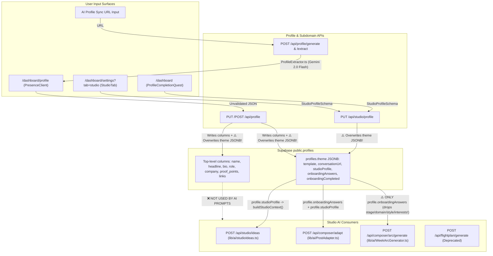

# UN OOL STUDIO — PROFILE SECTION: TESTING STRATEGY & AUDIT PREPARATION

**Document Type**: Pre-Audit Discovery, Architecture Map & Comprehensive Testing Strategy  
**Status**: Discovery & Planning Complete (No Code Modified; Audit Not Yet Executed)  
**Target Repository**: `UNOOLNEW` (`studio_prompt_audit_low_power` worktree & `main`)

---

## PHASE 1 — DISCOVER THE ACTUAL PROFILE IMPLEMENTATION

An exhaustive inspection of the repository reveals that the "Profile Section" in UN OOL Studio is **not a single isolated page**. Instead, it is a **three-headed architecture** spread across:
1. **The Public Presence / Bio-Link Builder** (`/dashboard/profile` and `/dashboard/presence`), stored in top-level `profiles` columns + `profiles.theme` JSONB.
2. **The Studio AI Persona & Voice Profile** (`/dashboard/settings?tab=studio` and the `/dashboard` Onboarding Quest), stored inside `profiles.theme.studio_profile` and legacy `profiles.theme.onboarding_answers` JSONB sub-keys.
3. **The Public-Facing Bio-Link & Brand Microsite** (`/u/[subdomain]` and `/u/[subdomain]/[slug]`), backed by `profiles`, `profile_viewers`, `brand_pages`, `posts`, and `analytics_events`.

Below is the complete, verified map across all 13 investigation areas.

---

### 1.1 Profile UI and All Related Components

| File Path | Lines | Responsibility & Verified Implementation |
| :--- | :--- | :--- |
| `app/dashboard/profile/page.tsx` | 1–26 | Server Component entry point for `/dashboard/profile`. Calls `getCurrentUser()`; redirects unauthenticated users to `/signin?redirect=/dashboard/profile`; renders `<PresenceClientWrapper />`. |
| `app/dashboard/presence/page.tsx` | 1–10 | Legacy/parallel route `/dashboard/presence` that also renders `<PresenceClient />` directly (without server-side auth redirect). |
| `app/dashboard/presence/PresenceClient.tsx` | 1–1737 | **Core Profile & Presence Editor**. A 1,737-line monolithic client component with two main workspace modes (`viewMode`: `'edit'` and `'analytics'`) and 4 editor tabs (`activeTab`: `'identity'`, `'proof'`, `'links'`, `'appearance'`). Manages auto-save (`1000ms` debounce), subdomain check/claim/release, AI URL sync (`/api/profile/generate` & `/api/profile/extract`), avatar file upload (`/api/profile/avatar`), template selection, "Open To" badges, proof points, custom links, and a live sticky preview pane (`ProfilePreview`). Also caches state in module-level globals (`memoryPresenceProfile`, `memoryPresenceClaimedSubdomain`, `memoryPresenceSubdomainInput`). |
| `app/dashboard/presence/presence.css` | 1–1200+ | Dedicated stylesheet for the Presence/Profile builder, split-pane layout, mobile drawer preview, and form controls. |
| `components/profile/ProfilePreview.tsx` | 1–102 | Renders a live preview of the user's `ProfileData` inside an `ErrorBoundary`. Resolves the selected template ID via `getTemplateById(templateId)` from `components/profile/templates/registry.ts` and falls back to `lover` (`LoverTemplate`) if the ID is unknown. |
| `components/profile/TemplateGallery.tsx` | 1–421 | Interactive template picker used inside `PresenceClient.tsx` (`Appearance` tab) and `TemplatesTab.tsx`. Supports category filtering (`all`, ` archetypes`, `modern`, `editorial`, `bold`, `3d`), search, live mini-previews, and a full-screen preview modal. Checks `isTemplateAllowedForPlan(templateId, templateCount)` and displays a lock badge (`Pro`) for locked templates, though clicking a locked card still triggers `onSelectTemplate` unless blocked upstream. |
| `components/profile/TemplateSelector.tsx` | 1–145 | Older/simpler 4-template selector (`minimalist`, `editorial`, `grid`, `bento`) using legacy template IDs that **do not exist** in `components/profile/templates/registry.ts`. |
| `components/profile/OpenToBadges.tsx` | 1–253 | Defines `OPEN_TO_OPTIONS` (`advising`, `investing`, `speaking`, `collaborating`, `mentoring`, `hiring`, `board-roles`, `consulting`, `cofounding`, `freelance`). Exports `<OpenToBadges>` (public rendering with optional mailto/URL CTA via `conversationUrl`) and `<OpenToSelector>` (used in the editor with `maxSelections = 5`). |
| `components/profile/RecentActivitySection.tsx` | 1–160 | Public profile component that renders recent published posts (`id`, `content`, `platforms`, `publishedAt`) below the user's profile template on `/u/[subdomain]`. |
| `components/profile/MadeWithUnoolCTA.tsx` | 1–65 | Viral footer badge ("Made with Unool") rendered on `/u/[subdomain]` when `showUnoolBadge !== false` (enforced for Free/Spark plans). |
| `components/profile/templates/registry.ts` | 1–538 | Registers **23 templates** across 5 categories: `lover`, `lone`, `energy`, `rebellion`, `vision`, `human`, `the-machine`, `the-club`, `the-builder`, `the-visionary`, `the-hustler`, `the-aesthete`, `the-creator`, `the-voice`, `the-studio`, `the-stack`, `the-bookshelf`, `the-cube`, `the-monolith`, `the-metro`, `the-noren`, `the-desktop`, `the-calendar`. Defines `SPARK_FREE_TEMPLATE_IDS = new Set(['lover', 'lone', 'energy', 'rebellion', 'vision', 'minimal'])` and `isTemplateAllowedForPlan()`. |
| `app/u/[subdomain]/page.tsx` | 1–367 | Public profile page (`/u/[subdomain]`). Client component that fetches `GET /api/profile/${subdomain}` on mount, normalizes legacy template names (`minimal` -> `lover`, `bold` -> `energy`, `creative` -> `vision`, `executive` -> `lone`), renders the dynamic template component, injects `customCss` via `<style dangerouslySetInnerHTML={{ __html: profile.theme.customCss }} />` (line 361), and sends link-click beacons to `POST /api/analytics/track`. |
| `app/u/[subdomain]/[slug]/page.tsx` & `BrandMaterialsPageView.tsx` | 1–120 | Sub-route under the user's public profile (`/u/[subdomain]/[slug]`) for rendering published Brand Material microsite pages. |

---

### 1.2 Profile Settings and Configuration

| File Path | Lines | Responsibility & Verified Implementation |
| :--- | :--- | :--- |
| `app/dashboard/settings/SettingsClient.tsx` | 1–481 | Settings hub (`/dashboard/settings`) with tabs: `account`, `studio`, `templates`, `analytics`, `connections`, `team`, `billing`, `notifications`, `security`, `appearance`. Its **`account` tab** also edits `profileData.name` and `profileData.bio` and saves via `PUT /api/profile` (`handleSaveProfile`, lines 173–204) and uploads avatars via `POST /api/profile/avatar` (`handleAvatarChange`, lines 206–234). |
| `components/dashboard/settings/tabs/StudioTab.tsx` | 1–569 | **Studio AI Profile Editor** (`/dashboard/settings?tab=studio`). Fetches `GET /api/studio/profile` and saves via `PUT /api/studio/profile`. Edits `role`, `businessStage`, `businessDomain`, `style` (max 3), `goals` (max 3), `workInterests` (max 5), `platforms` (max 3), `cadence`, plus custom array entries (`custom.roles`, `custom.styles`, `custom.goals`, `custom.interests`, `custom.domains`). Also triggers "Replay Studio Walkthrough". |
| `components/dashboard/settings/tabs/TemplatesTab.tsx` | 1–143 | Duplicate template switcher inside `/dashboard/settings?tab=templates`. Loads current template from `GET /api/profile` and saves only `{ theme: { template } }` via `PUT /api/profile` (lines 48–62). |
| `components/dashboard/settings/tabs/TemplateAnalyticsTab.tsx` | 1–532 | Standalone template analytics dashboard inside `/dashboard/settings?tab=analytics`, querying `GET /api/profile/analytics?range=...`. |

---

### 1.3 API Routes and Backend Operations

| Endpoint | File Path | Methods | Responsibility & Auth |
| :--- | :--- | :--- | :--- |
| `/api/profile` | `app/api/profile/route.ts` | `GET`, `PUT`, `POST`, `DELETE` | Core authenticated CRUD for the current user's/workspace's profile. Resolves profile by `workspaceId` first, then falls back to `userId`. Enforces `isTemplateAllowedForPlan` on `theme.template`. Supports optimistic concurrency via `version` on `PUT`. Soft-deletes (`deleted_at`) on `DELETE`. |
| `/api/profile/avatar` | `app/api/profile/avatar/route.ts` | `POST` | Multipart avatar upload (`max 5MB`, `image/*`). Uploads buffer to Cloudflare R2 bucket `avatars` (`R2StorageService.uploadBuffer`) and persists `avatarUrl` on the user's profile (or creates a minimal profile if none exists). |
| `/api/profile/generate` | `app/api/profile/generate/route.ts` | `POST` | AI URL scraper/extractor. Validates `{ url }` via Zod, calls `ProfileExtractor.extractFromUrl(url)`, and returns extracted `{ name, headline, bio, role, company, links, proofPoints }`. Does **not** write to DB directly. |
| `/api/profile/extract` | `app/api/profile/extract/route.ts` | `POST` | Near-duplicate of `/api/profile/generate` (identical `ProfileExtractor.extractFromUrl(url)` call, wraps result in `{ success: true, data: extracted }`). Called by `PresenceClient.tsx` as a fallback when `/api/profile/generate` fails! |
| `/api/profile/onboarding` | `app/api/profile/onboarding/route.ts` | `GET`, `PUT`, `POST` | Reads and updates `onboardingCompleted` and `onboardingAnswers` inside `profiles.theme`. Auto-creates a profile with subdomain `user-${userId.slice(0,8)}` if none exists. |
| `/api/studio/profile` | `app/api/studio/profile/route.ts` | `GET`, `PUT` | Reads and updates `studioProfile` (Zod-validated `StudioProfileSchema`), `onboardingCompleted`, and backwards-compatible `onboardingAnswers` inside `profiles.theme`. |
| `/api/profile/studio` | `app/api/profile/studio/route.ts` | `GET`, `PUT` | 1-line barrel alias (`export { GET, PUT } from '@/app/api/studio/profile/route'`). |
| `/api/profile/[subdomain]` | `app/api/profile/[subdomain]/route.ts` | `GET` | Public endpoint for `/u/[subdomain]`. Looks up profile by lowercase subdomain, checks `visibility === 'private'` (returns `404`), checks workspace subscription plan (`hasCustomBranding`), fetches up to 5 recent `published` posts from `posts` table, and asynchronously logs a `profile_view` event into `analytics_events`. |
| `/api/profile/analytics` | `app/api/profile/analytics/route.ts` | `GET` | Aggregates `profile_view` and `link_click` events from `analytics_events` for `7d`, `30d`, `90d`, or `all` ranges, computing views, unique visitors, CTR, daily trend, referrers, device breakdown, top links, and per-template conversion metrics. |
| `/api/profile/viewers` | `app/api/profile/viewers/route.ts` | `GET`, `POST`, `DELETE` | Manages authorized viewers (`profile_viewers` table) for private profiles by resolving an invited `email` via `supabaseAdmin.from('users')` and inserting `{ profile_id, user_id }`. |
| `/api/subdomains/check` | `app/api/subdomains/check/route.ts` | `GET` | Public endpoint (`?subdomain=...`) checking regex (`^[a-z0-9][a-z0-9-]*[a-z0-9]$`, min length 2), reserved words list (27 words), and existing `profiles.subdomain` match via `supabaseAdmin`. |
| `/api/subdomains/claim` | `app/api/subdomains/claim/route.ts` | `POST` | Authenticated endpoint to claim a subdomain. Validates format and reserved words (30 words—adds `ftp`, `ssh`, `vpn` missing from `check`), checks collisions, and updates or creates the user's `profiles` row. |
| `/api/subdomains/[subdomain]` | `app/api/subdomains/[subdomain]/route.ts` | `DELETE` | Authenticated endpoint to release a claimed subdomain. Verifies ownership and resets `profiles.subdomain` to `user-${auth.userId.slice(0, 8)}-${Date.now().toString(36)}`. |

---

### 1.4 Database Tables, Relationships, and Migrations

1. **`public.profiles` Table**:
   - **Core Columns**: `id` (UUID PK), `user_id` (UUID FK -> `auth.users`), `workspace_id` (UUID FK -> `workspaces`), `subdomain` (TEXT), `name` (TEXT), `headline` (TEXT), `bio` (TEXT), `avatar_url` (TEXT), `role` (TEXT), `company` (TEXT), `links` (JSONB array), `proof_points` (JSONB array), `open_to` (TEXT[] / JSONB), `theme` (JSONB), `visibility` (`'public' | 'private'`), `version` (INT), `deleted_at` (TIMESTAMPTZ), `created_at` (TIMESTAMPTZ), `updated_at` (TIMESTAMPTZ).
   - **Overloaded `profiles.theme` JSONB Column**:
     Instead of using dedicated SQL columns (even though migrations `20261014140000` and `20261015110000` added `studio_onboarding_completed`, `studio_onboarding_answers`, and `studio_profile` columns to `public.profiles`), `SupabaseProfileRepository.ts` (lines 28–30, 143–151, 211–215) actually reads and writes `onboardingCompleted`, `onboardingAnswers`, and `studioProfile` **inside the `profiles.theme` JSONB column** alongside `template`, `conversationUrl`, `accentColor`, `preset`, and `customCss`!
2. **`public.profile_viewers` Table** (`supabase/migrations/20260923232041_add_profile_visibility.sql`):
   - Columns: `id` (UUID PK), `profile_id` (UUID FK -> `profiles.id` ON DELETE CASCADE), `user_id` (UUID FK -> `auth.users.id` ON DELETE CASCADE), `added_at` (TIMESTAMPTZ), `UNIQUE(profile_id, user_id)`.
3. **`public.analytics_events` Table**:
   - Stores `event_type IN ('profile_view', 'link_click')` with `workspace_id`, `user_id`, `properties` JSONB (`subdomain`, `profile_id`, `referrer`, `user_agent`, `template_id`, `link_url`, `link_text`, `visitor_id`).
4. **Key Migrations**:
   - `20260923232041_add_profile_visibility.sql`: Adds `visibility` (`'public' | 'private'`) to `profiles` and creates `profile_viewers`.
   - `20261014140000_add_studio_onboarding_to_profiles.sql`: Adds `studio_onboarding_completed` and `studio_onboarding_answers` columns to `profiles` (**unused by repository**, which stores them in `theme` JSONB instead).
   - `20261015110000_add_studio_profile_to_profiles.sql`: Adds `studio_profile` column to `profiles` (**unused by repository**, which stores `studioProfile` in `theme.studioProfile` JSONB instead).
   - `20261021000001_enable_profiles_rls_public.sql`: Enables RLS on `profiles` and adds policy `"Public profiles are viewable by everyone" ON public.profiles FOR SELECT USING (visibility = 'public' OR visibility IS NULL)`.
   - `20261021000002_unique_subdomain_partial_index.sql`: Drops full unique constraint on `subdomain` and creates partial unique index `idx_profiles_subdomain_unique ON public.profiles (LOWER(subdomain)) WHERE deleted_at IS NULL`.
   - `20261030000001_ensure_profiles_deleted_at.sql`: Ensures `deleted_at` column and partial index exist.

---

### 1.5 Authentication and Authorization

- **Page-Level Auth**:
  - `app/dashboard/profile/page.tsx` checks `getCurrentUser()` on the server and redirects to `/signin?redirect=/dashboard/profile`.
  - `app/dashboard/presence/page.tsx` does **not** perform a server-side auth check (relies on `app/dashboard/layout.tsx`).
- **API-Level Auth**:
  - `/api/profile`, `/api/profile/avatar`, `/api/profile/generate`, `/api/profile/extract`, `/api/profile/onboarding`, `/api/studio/profile`, `/api/profile/viewers`, `/api/subdomains/claim`, and `/api/subdomains/[subdomain]` call `getCurrentAuth(request)` (`lib/middleware/auth.ts`).
  - **CRITICAL VULNERABILITY DISCOVERED in `/api/profile/analytics` (`app/api/profile/analytics/route.ts`, lines 77–84)**:
    ```ts
    const auth = await getCurrentAuth(request);
    const { searchParams } = new URL(request.url);
    const queryWorkspaceId = searchParams.get('workspaceId');
    const effectiveWorkspaceId = auth?.workspaceId || queryWorkspaceId;
    const effectiveUserId = auth?.userId;
    if (!effectiveWorkspaceId && !effectiveUserId) {
      return NextResponse.json({ error: 'Unauthorized' }, { status: 401 });
    }
    ```
    If an unauthenticated caller passes `?workspaceId=<any-uuid>`, `effectiveWorkspaceId` is truthy, bypassing the `401` check, and the handler proceeds to query `profiles` and `analytics_events` using `supabaseAdmin` (service role)!
- **Service Role Usage**:
  - `SupabaseProfileRepository` uses `supabaseAdmin` (`service_role`), bypassing Postgres RLS entirely. All ownership and tenant isolation therefore depend strictly on application-layer checks in each route handler.

---

### 1.6 User and Workspace Relationships

- A `Profile` row has both `user_id` and `workspace_id`.
- **Dual-Lookup Ambiguity**:
  In `app/api/profile/route.ts` (`GET`, `PUT`, `DELETE`), `/api/profile/onboarding`, `/api/studio/profile`, and `/api/subdomains/claim`:
  ```ts
  let profile = auth.workspaceId ? await profileRepo.findByWorkspaceId(auth.workspaceId) : null;
  if (!profile) {
    profile = await profileRepo.findByUserId(auth.userId);
  }
  ```
  - **Why this matters**: If a user owns multiple workspaces (or switches workspaces via the workspace/account switcher), `findByWorkspaceId(newWorkspaceId)` returns `null` if the second workspace has no profile yet, and the fallback `findByUserId(auth.userId)` **returns the profile belonging to the user's FIRST workspace**! Subsequent edits in Workspace B silently mutate Workspace A's profile (or fail if `findByUserId` calls `.single()` when the user has 2+ profiles across workspaces!).
  - Furthermore, in `SupabaseProfileRepository.ts` (lines 79 and 93), `findByUserId` and `findByWorkspaceId` both use `.single()`, which fails with `PGRST116` (`JSON object requested, multiple (or no) rows returned`) if more than one row matches (including soft-deleted rows!).

---

### 1.7 Profile Creation, Editing, Updating, and Deletion

- **Creation (`POST /api/profile` or upsert on `PUT /api/profile`)**:
  - Triggered when a user edits any field in `PresenceClient.tsx` (`saveProfile` chooses `POST` if `!profile.id`, `PUT` if `profile.id`), or when claiming a subdomain (`POST /api/subdomains/claim`), uploading an avatar (`POST /api/profile/avatar`), or completing Studio onboarding (`PUT /api/studio/profile`).
- **Editing & Auto-Save (`PresenceClient.tsx` lines 476–527)**:
  - Uses a `1000ms` `setTimeout` debounce on `[profile, loading, claimedSubdomain]` after `initialLoadDone.current === true`.
  - **CRITICAL BUG DISCOVERED (Free/Spark Users Blocked From Creating/Saving Profiles)**:
    - `PresenceClient.tsx` line 151 sets `const DEFAULT_TEMPLATE = 'minimalist'`, and line 229 initializes new profiles with `theme: { template: 'minimalist' }`.
    - `components/profile/templates/registry.ts` line 516 defines `SPARK_FREE_TEMPLATE_IDS = new Set(['lover', 'lone', 'energy', 'rebellion', 'vision', 'minimal'])`. `'minimalist'` is **not** in `SPARK_FREE_TEMPLATE_IDS`!
    - When a Spark (Free) user (`templateCount = 5`) types their name or bio for the first time, auto-save sends `theme: { template: 'minimalist' }` to `POST /api/profile`.
    - `app/api/profile/route.ts` line 112 checks `isTemplateAllowedForPlan('minimalist', 5)` -> returns `false` -> returns **HTTP 403 `PLAN_LIMIT_EXCEEDED`**! The user sees a red `"Failed"` badge in the header and cannot save their profile until they manually switch away from the default template.
- **Updating Studio AI Profile (`PUT /api/studio/profile`)**:
  - **CRITICAL DATA-LOSS BUG DISCOVERED (`SupabaseProfileRepository.ts` lines 143–151)**:
    ```ts
    let themeObj: Record<string, unknown> = (data.theme as Record<string, unknown>) || {};
    if (data.onboardingCompleted !== undefined || data.onboardingAnswers !== undefined || data.studioProfile !== undefined) {
      themeObj = {
        ...themeObj,
        ...(data.onboardingCompleted !== undefined ? { onboardingCompleted: data.onboardingCompleted } : {}),
        ...(data.onboardingAnswers !== undefined ? { onboardingAnswers: data.onboardingAnswers } : {}),
        ...(data.studioProfile !== undefined ? { studioProfile: data.studioProfile } : {}),
      };
      updateData.theme = themeObj;
    }
    ```
    When `PUT /api/studio/profile` (`app/api/studio/profile/route.ts` lines 98–116) or `PUT /api/profile/onboarding` calls `profileRepo.update(profile.id, { studioProfile, onboardingCompleted, onboardingAnswers })`, it **does not pass `theme: profile.theme`**. Consequently, `data.theme` is `undefined`, `themeObj` starts as `{}`, and `updateData.theme` **completely overwrites the `profiles.theme` JSONB column in Postgres**, wiping out `theme.template`, `theme.conversationUrl`, `theme.accentColor`, and `theme.customCss`!
- **Deletion (`DELETE /api/profile`)**:
  - Soft-deletes by setting `deleted_at = new Date().toISOString()`.
  - **CRITICAL BUG DISCOVERED**: None of the query methods in `SupabaseProfileRepository.ts` (`findById`, `findBySubdomain`, `findByUserId`, `findByWorkspaceId`) filter `.is('deleted_at', null)`! Thus, a "deleted" profile is still returned by `GET /api/profile` and **still renders publicly** on `/u/[subdomain]`!
  - Furthermore, there is **no UI button** anywhere in `/dashboard/profile` or `/dashboard/settings` that calls `DELETE /api/profile`.

---

### 1.8 Form Validation and Error Handling

- **`PUT /api/studio/profile`**: Strong Zod validation (`StudioProfileSchema` in `app/api/studio/profile/route.ts`, lines 14–29) enforcing max array lengths (`style <= 3`, `goals <= 3`, `workInterests <= 5`, `platforms <= 3`) and custom string limits (`max 60 chars`).
- **`PUT` & `POST /api/profile`**: **Zero schema/Zod validation**.
  - Accepts arbitrary types/lengths for `name`, `headline`, `bio`, `role`, `company`, `avatarUrl`, `links`, `proofPoints`, `openTo`, and `theme`.
  - Does **not** validate URL schemes (`http:`/`https:`) on `links[].url`, `proofPoints[].url`, `avatarUrl`, or `theme.conversationUrl`—allowing `javascript:` URIs (Stored XSS on `/u/[subdomain]`).
  - Does **not** sanitize `theme.customCss`, which `/u/[subdomain]/page.tsx` line 361 injects raw via `<style dangerouslySetInnerHTML={{ __html: profile.theme.customCss }} />`—allowing `</style><script>...` breakout XSS!
  - **Dead Uniqueness Check on `PUT /api/profile` (`app/api/profile/route.ts` lines 135 vs. 181–188)**:
    If aprofile does not exist yet and `PUT /api/profile` creates it at line 135 (`profile = await profileRepo.create(...)`), or if `profile` exists and is updated at line 145 (`profile = await profileRepo.update(...)`), the subdomain uniqueness check at line 181 (`if (subdomain && subdomain !== profile.subdomain)`) runs **after** the DB write and compares `subdomain` against the already-updated `profile.subdomain`, making the check unreachable dead code!

---

### 1.9 Data Persistence and Synchronization

- **In-Memory Module Cache Desync (`PresenceClient.tsx` lines 174–176)**:
  - `PresenceClient.tsx` caches `memoryPresenceProfile`, `memoryPresenceClaimedSubdomain`, and `memoryPresenceSubdomainInput` at module scope (`Presence CACHE_TTL_MS = 60_000`).
  - However, `saveProfile()` (`lines 506–522`) **never updates `memoryPresenceProfile`** after an auto-save! If a user edits their profile, waits for "Saved", navigates to `/dashboard` within 60 seconds, and returns to `/dashboard/profile`, `PresenceClient` initializes from the stale `memoryPresenceProfile` snapshot until the background fetch completes.
  - Similarly, `handleDeleteSubdomain()` (`lines 410–425`) calls `await loadProfile()` which leaves `memoryPresenceClaimedSubdomain` populated if `loadProfile()` doesn't explicitly clear it when `subdomain.startsWith('user-')`.
- **Settings vs. Profile Editor Desync**:
  - Editing `name`, `bio`, or `avatar` in `/dashboard/settings` (`SettingsClient.tsx`) or changing templates in `/dashboard/settings?tab=templates` (`TemplatesTab.tsx`) does not invalidate `memoryPresenceProfile` in `PresenceClient.tsx`.
  - Worse, `TemplatesTab.tsx` (line 53) sends `PUT /api/profile` with `{ theme: { template } }`, which overwrites `profile.theme` in `SupabaseProfileRepository.update()`, **erasing `studioProfile`, `onboardingCompleted`, `onboardingAnswers`, and `conversationUrl`**!

---

### 1.10 AI-Related Profile Information and Personalization

1. **Inbound AI (URL -> Profile Autofill)**:
   - `lib/ai/ProfileExtractor.ts` scrapes a user-provided URL (`fetchPageContent`, 5s timeout, strips HTML tags to 6,000 chars) and prompts Gemini (`gemini-2.0-flash`) to extract `{ name, headline, bio, role, company, links, proofPoints }`.
   - **Hallucination / Destructive Overwrite Risk**: When scraping fails (e.g., LinkedIn returns HTTP 999/login wall, even though the UI input placeholder at `PresenceClient.tsx` line 859 literally says `placeholder="https://linkedin.com/in/yourname"`!), `ProfileExtractor` falls back to `createDefaultProfile(url)` (lines 95–111), which fabricates `{ name: "Linkedin", headline: "Creator & Builder at linkedin.com", company: "linkedin.com" }`. `PresenceClient.tsx` (lines 351–362) immediately sets this into `profile` state, and 1 second later auto-save **overwrites the user's real profile in the database with "Linkedin"**!
2. **Outbound AI (Profile -> Studio Content Generation)**:
   - `lib/ai/studioContext.ts` (`buildStudioContext`) converts `StudioProfile` into a structured prompt block (`Creator Profile: Role, Stage, Domain, Tone/Style, Content Goals, Topics, Platforms, Cadence`) and tone/platform hints.
   - Consumed by:
     - `app/api/studio/ideas/route.ts` -> `lib/ai/studioIdeas.ts` (Dashboard "Get Today's Ideas" generator).
     - `app/api/composer/adapt/route.ts` -> `lib/ai/PostAdapter.ts` (Studio multi-platform adaptation).
     - `app/api/composer/arc/route.ts` & `app/api/composer/arc/generate/route.ts` -> `lib/ai/WeekArcGenerator.ts` (7-day narrative arc generator).
     - `app/api/flightplan/generate/route.ts` (legacy/deprecated Flight Plan generator).

---

### 1.11 Integrations with Other Studio Features

- **Dashboard Overview (`/dashboard`) & `ProfileCompletionQuest.tsx`**:
  - `app/dashboard/page.tsx` fetches the profile server-side (`profileRepo.findByWorkspaceId` / `findByUserId`) and passes `studioProfileCompleted` and `studioProfile` to `DashboardClient.tsx`.
  - If `!studioProfileCompleted`, `/dashboard` renders `<ProfileCompletionQuest />` (a 7-step interactive wizard that saves to `PUT /api/studio/profile`) and blocks `<StudioIdeaGenerator />` behind a "Complete your Studio Profile first" CTA.
- **Composer / Studio (`/dashboard/studio`)**:
  - `POST /api/composer/adapt` (`app/api/composer/adapt/route.ts`, lines 89–94) requires a `profiles` row to exist (`if (!profile) return NextResponse.json({ error: 'No profile found for workspace. Create a profile first.' }, { status: 400 })`).
- **Public Profile Recent Activity (`/u/[subdomain]`)**:
  - `GET /api/profile/[subdomain]` queries `posts` (`status = 'published'`, `deleted_at IS NULL`, limit 5) for the profile's `workspace_id` and displays them in `<RecentActivitySection />`.
- **Brand Materials (`/u/[subdomain]/[slug]`)**:
  - Resolves `subdomain` via `profiles` to render workspace brand pages under the user's custom handle.
- **Plan / Billing Enforcement (`lib/config/plans.ts` & `lib/services/PlanEnforcementService.ts`)**:
  - `templateCount`: Spark (Free) = `5` templates (`lover`, `lone`, `energy`, `rebellion`, `vision`); Creator/Pro/Agency = `-1` (all 23 templates).
  - `hasCustomBranding`: Spark (Free) = `false` (forces `<MadeWithUnoolCTA />` badge on `/u/[subdomain]`); paid plans = `true` (hides Unool badge).

---

### 1.12 Loading, Empty, Error, and Success States

- **Loading States**:
  - `PresenceClient.tsx` (lines 684–690): Shows a full-page spinner (`"Loading your profile..."`) only when `loading && !memoryPresenceProfile`.
  - `/u/[subdomain]/page.tsx` (lines 172–194): Shows a skeleton loader while fetching `/api/profile/${subdomain}`.
- **Save / Status Indicators**:
  - `PresenceClient.tsx` header (lines 721–737): Displays `"Saving..."`, `"Saved"` (with checkmark), or `"Failed"` (with alert icon). **Flaw**: When `saveStatus === 'error'`, no error message or toast explains *why* the save failed (e.g., 403 locked template vs. 409 conflict vs. 500 server error).
- **Error & Empty States**:
  - `/u/[subdomain]/page.tsx` (lines 196–234): Renders a "Profile Not Found" state with a "Claim @{subdomain}" CTA when `/api/profile/${subdomain}` returns 404.
  - `TemplateAnalyticsTab.tsx` / `PresenceClient.tsx` analytics mode: Renders empty charts or `"No link clicks recorded yet"` when `analytics_events` is empty.

---

### 1.13 Existing Tests and Test Coverage

Only **4 test files** in the entire repository touch any part of the Profile system:
1. `app/api/studio/profile/__tests__/route.test.ts` (177 lines): Unit tests for `GET` and `PUT /api/studio/profile` using a mocked `profileRepo`.
2. `components/dashboard/__tests__/ProfileCompletionQuest.test.tsx` (101 lines): Component test for stepping through the 7-step Studio onboarding wizard.
3. `lib/config/__tests__/studioOnboarding.test.ts`: Tests static option constants in `lib/config/studioOnboarding.ts`.
4. `e2e/public-profile.spec.ts` (251 lines): Playwright spec for `/u/[subdomain]` and `/dashboard/profile`—**90% of its assertions are guarded by `if (await element.isVisible())` no-ops or rely on mocked routes**!

**Zero unit or integration tests exist for**:
- `app/api/profile/route.ts` (`GET`, `PUT`, `POST`, `DELETE`)
- `app/api/profile/[subdomain]/route.ts`
- `app/api/profile/avatar/route.ts`
- `app/api/profile/generate/route.ts` & `extract/route.ts` (`ProfileExtractor.ts`)
- `app/api/profile/analytics/route.ts`
- `app/api/profile/viewers/route.ts`
- `app/api/subdomains/check/route.ts`, `claim/route.ts`, `[subdomain]/route.ts`
- `lib/repositories/supabase/SupabaseProfileRepository.ts`
- `app/dashboard/presence/PresenceClient.tsx`

---

## PHASE 2 — EXPLAIN WHAT YOU WOULD TEST

Below is the comprehensive, high-signal test catalog (`PROF-01` through `PROF-38`) tailored specifically to UN OOL Studio's actual implementation. Every test targets a concrete mechanism, boundary, or discovered defect.

---

### Group A: Profile Creation, Auto-Save & Plan Template Gating

#### `PROF-01`: First-Time Profile Auto-Save on Spark (Free) Plan (`DEFAULT_TEMPLATE` Mismatch)
- **Feature**: Profile creation & auto-save (`PresenceClient.tsx` + `POST /api/profile`).
- **What to Test**: A newly registered user on the default Spark (Free) plan (`templateCount = 5`) opens `/dashboard/profile`, types their `name` and `headline`, and waits `1000ms` for auto-save.
- **Why Necessary**: `PresenceClient.tsx` (line 151) sets `DEFAULT_TEMPLATE = 'minimalist'`, which is **not** in `SPARK_FREE_TEMPLATE_IDS` (`['lover', 'lone', 'energy', 'rebellion', 'vision', 'minimal']` in `registry.ts` line 516). `POST /api/profile` rejects `'minimalist'` for Spark users with HTTP `403 PLAN_LIMIT_EXCEEDED`.
- **How to Perform**: Authenticate as a new Spark user with no `profiles` row; open `/dashboard/profile`; enter `"Ada Lovelace"` in Full Name; observe network response for `POST /api/profile` and header `saveStatus`.
- **Expected Behaviour**: Default template initialized by `PresenceClient.tsx` must be an allowed free template (e.g., `'lover'`), and `POST /api/profile` must succeed with `201 Created` and display `"Saved"`.
- **Possible Failure Scenarios**: `POST /api/profile` returns `403 {"error": "Template requires a paid plan", "code": "PLAN_LIMIT_EXCEEDED"}`, header shows `"Failed"`, and all profile edits are lost on refresh.
- **Evidence Required**: Network HAR/trace of `POST /api/profile` status code & payload + DB query on `public.profiles`.
- **Test Type**: Integration & End-to-End.
- **Priority**: **Critical**.

#### `PROF-02`: Paid vs. Free Template Enforcement Across Editor & API
- **Feature**: Plan-based template gating (`TemplateGallery.tsx`, `PresenceClient.tsx`, `PUT /api/profile`).
- **What to Test**:
  1. Spark (Free) user selects each of the 5 free templates (`lover`, `lone`, `energy`, `rebellion`, `vision`) -> succeeds (`200`).
  2. Spark user clicks or sends API `PUT /api/profile` with any of the 18 Pro templates (e.g., `the-machine`, `the-cube`) -> blocked in UI with upgrade prompt and rejected by API with `403`.
  3. Creator/Pro user (`templateCount = -1`) selects any of the 23 templates -> succeeds (`200`).
- **Why Necessary**: In `TemplateGallery.tsx` (line 277), clicking a locked template card still calls `onSelectTemplate(template.id)`, which updates `profile.theme.template` in `PresenceClient.tsx` and triggers a failing `403` auto-save loop every time the user edits another field!
- **How to Perform**: Automated integration test calling `PUT /api/profile` with all 23 template IDs under Spark (`templateCount = 5`) and Pro (`templateCount = -1`), plus UI interaction clicking a locked card in `TemplateGallery`.
- **Expected Behaviour**: Locked templates cannot be activated into `profile.theme.template` on the client without upgrading, and API enforces `isTemplateAllowedForPlan`.
- **Possible Failure Scenarios**: Selecting a locked template in `TemplateGallery` mutates local `profile.theme.template`, breaking all subsequent auto-saves for text fields (`name`, `bio`) with `403`.
- **Evidence Required**: Vitest route test output + Playwright trace on `Appearance` tab.
- **Test Type**: Unit, Integration & End-to-End.
- **Priority**: **Critical**.

#### `PROF-03`: Optimistic Concurrency Control (`version`) & Rapid Auto-Save Race Conditions
- **Feature**: `PUT /api/profile` version checking (`app/api/profile/route.ts` lines 140–153) & `PresenceClient.tsx` auto-save.
- **What to Test**: Rapid consecutive edits across fields (typing in `name`, pausing `1000ms`, typing again while the first `PUT /api/profile` is in flight) and two open browser tabs editing the same profile.
- **Why Necessary**: `PUT /api/profile` checks `version`, incrementing `existing.version + 1` in `SupabaseProfileRepository.update()` (line 138). However, `PresenceClient.tsx` (`saveProfile`, lines 489–522) **never sends `version` in the `PUT` body** and **never updates local `profile.version` from the response**!
- **How to Perform**:
  1. Inspect `PUT /api/profile` request payload from `PresenceClient.tsx` (verify whether `version` is omitted).
  2. Send `PUT /api/profile` with stale `version: 1` when DB is at `version: 2` -> verify `409 Conflict` (`CONFLICT`).
  3. Test two concurrent `PUT` requests in `SupabaseProfileRepository.update` to check if the SQL `UPDATE` uses `.eq('version', expectedVersion)` (atomic compare-and-swap) or a non-atomic read-then-write.
- **Expected Behaviour**: True optimistic concurrency requires `.eq('version', data.version)` in the SQL `UPDATE` query and client tracking of `version`.
- **Possible Failure Scenarios**: `SupabaseProfileRepository.update()` (lines 110–160) reads `existing` and then runs `.update(updateData).eq('id', id)` **without `.eq('version', existing.version)`**—meaning concurrent requests still overwrite each other (TOCTOU race condition).
- **Evidence Required**: Integration test firing concurrent `PUT /api/profile` requests with `version` assertions.
- **Test Type**: Integration.
- **Priority**: **High**.

---

### Group B: JSONB `profiles.theme` Cross-Feature Clobbering (Data Integrity)

#### `PROF-04`: Saving Studio AI Profile (`PUT /api/studio/profile`) Preserves Public Profile `theme`
- **Feature**: `PUT /api/studio/profile` + `SupabaseProfileRepository.update()`.
- **What to Test**: Configure a public profile with `theme: { template: 'the-machine', conversationUrl: 'https://cal.com/alex', accentColor: '#ff0000' }`. Then go to `/dashboard/settings?tab=studio` (or `ProfileCompletionQuest`) and save Studio AI preferences via `PUT /api/studio/profile`. Immediately inspect `profiles.theme` in DB and load `/u/[subdomain]`.
- **Why Necessary**: `SupabaseProfileRepository.update()` (lines 143–151) initializes `let themeObj = data.theme || {}` and assigns `updateData.theme = themeObj` whenever `studioProfile` is updated. Because `PUT /api/studio/profile` does not pass `theme: profile.theme`, saving Studio AI preferences **erases `template`, `conversationUrl`, `accentColor`, and `customCss`**!
- **How to Perform**: Integration test: create profile with `theme.template = 'vision'` and `theme.conversationUrl = 'mailto:test@example.com'`, call `PUT /api/studio/profile`, then call `GET /api/profile` and assert `theme.template === 'vision'` and `theme.conversationUrl === 'mailto:test@example.com'`.
- **Expected Behaviour**: Updating `studioProfile` merges into existing `existing.theme` without deleting `template` or `conversationUrl`.
- **Possible Failure Scenarios**: `theme.template` becomes `undefined` (resetting public profile to default `lover` template) and `theme.conversationUrl` is wiped out.
- **Evidence Required**: Before/after `profiles.theme` JSONB snapshot from integration test.
- **Test Type**: Integration.
- **Priority**: **Critical**.

#### `PROF-05`: Saving Public Profile (`PUT /api/profile`) or Settings Template (`TemplatesTab`) Preserves `studioProfile` & `onboardingCompleted`
- **Feature**: `PUT /api/profile` from `PresenceClient.tsx`, `SettingsClient.tsx`, and `TemplatesTab.tsx`.
- **What to Test**:
  1. Complete Studio AI Onboarding (`onboardingCompleted: true`, `studioProfile: { role: 'founder', ... }`).
  2. Go to `/dashboard/settings?tab=templates` (`TemplatesTab.tsx` line 53) and select a template (which sends `PUT /api/profile` with `{ theme: { template: 'energy' } }`).
  3. Go back to `/dashboard` and `/dashboard/settings?tab=studio`.
- **Why Necessary**: `TemplatesTab.tsx` sends `theme: { template }` without `studioProfile` or `onboardingCompleted`. In `SupabaseProfileRepository.update()`, `updateData.theme = data.theme` overwrites the entire `theme` JSONB column with `{ template: 'energy' }`, **wiping out the user's entire Studio AI Profile and resetting `onboardingCompleted` to `false`**!
- **How to Perform**: Integration test calling `PUT /api/studio/profile`, then `PUT /api/profile` with `{ theme: { template: 'energy' } }`, then `GET /api/studio/profile`.
- **Expected Behaviour**: `studioProfile`, `onboardingCompleted`, and `onboardingAnswers` remain intact when `theme.template` is updated.
- **Possible Failure Scenarios**: `GET /api/studio/profile` returns `studioProfile: null, completed: false`, and `/dashboard` re-prompts the user with the 7-step `ProfileCompletionQuest` as if they were a brand-new user!
- **Evidence Required**: Integration test output + DB inspection of `profiles.theme`.
- **Test Type**: Integration & End-to-End.
- **Priority**: **Critical**.

#### `PROF-06`: Editing Account Name/Bio in `/dashboard/settings` (`SettingsClient.tsx`) Does Not Corrupt Profile
- **Feature**: `SettingsClient.tsx` (`handleSaveProfile`, lines 173–204).
- **What to Test**: Save `name` and `bio` from `/dashboard/settings?tab=account` (`PUT /api/profile` with `{ name, bio }`), then verify `/dashboard/profile` (`PresenceClient.tsx`) and `/u/[subdomain]` reflect the updated `name` and `bio` without losing `headline`, `links`, `proofPoints`, `openTo`, or `theme`.
- **Why Necessary**: Two separate UIs (`SettingsClient.tsx` and `PresenceClient.tsx`) write to `PUT /api/profile` with different payload shapes, and `PresenceClient.tsx` holds a 60s module-level cache (`memoryPresenceProfile`).
- **How to Perform**: Edit name in `/dashboard/settings`, click Save, immediately navigate to `/dashboard/profile` via sidebar.
- **Expected Behaviour**: `/dashboard/profile` displays the new name immediately and retains all other fields.
- **Possible Failure Scenarios**: `memoryPresenceProfile` serves stale name in `/dashboard/profile`, which then triggers auto-save and overwrites the Settings change!
- **Evidence Required**: Playwright multi-page navigation test.
- **Test Type**: End-to-End.
- **Priority**: **High**.

---

### Group C: Subdomain Lifecycle (`check`, `claim`, `release`, `soft-delete`)

#### `PROF-07`: Subdomain Validation Parity Between Client (`PresenceClient`), `/api/subdomains/check`, `/api/subdomains/claim`, and `PUT /api/profile`
- **Feature**: Subdomain validation rules across all 4 entry points.
- **What to Test**:
  1. 2-character subdomain (e.g., `"ab"`): `check` and `claim` allow `length >= 2`, but `PresenceClient.tsx` line 380 requires `subdomain.length >= 3` (`checkSubdomain` exits early for 2 chars, keeping the "Claim" button disabled!).
  2. Reserved words `ftp`, `ssh`, `vpn`: `GET /api/subdomains/check?subdomain=vpn` returns `{ available: true }` because `check/route.ts` (lines 33–40) is missing `'ftp'`, `'ssh'`, `'vpn'`, whereas `POST /api/subdomains/claim` (line 36) rejects `'vpn'` with `400 This subdomain is reserved`!
  3. Overlong subdomain (`> 63` chars) or uppercase characters (`"MyHandle"`).
  4. Direct bypass via `PUT /api/profile` with `{ subdomain: "admin" }` or `{ subdomain: "INVALID SPACE!" }`.
- **Why Necessary**: `PUT /api/profile` (`app/api/profile/route.ts` line 82 & 126) accepts `subdomain` in the JSON body **without running the regex or `RESERVED_SUBDOMAINS` check**, allowing any user to claim `"admin"`, `"api"`, `"dashboard"`, or invalid characters directly via `PUT /api/profile`!
- **How to Perform**: Send requests with 2-char, >63-char, reserved (`admin`, `vpn`), and invalid (`a_b`, `-abc`) subdomains to `/api/subdomains/check`, `/api/subdomains/claim`, and `PUT /api/profile`.
- **Expected Behaviour**: One canonical subdomain validator shared across client, `check`, `claim`, and `PUT/POST /api/profile`.
- **Possible Failure Scenarios**: User claims `"admin"` via `PUT /api/profile`; user sees `"vpn is available!"` in UI but gets error on click Claim; 2-char handles cannot be claimed in UI.
- **Evidence Required**: API test matrix responses for all 4 endpoints.
- **Test Type**: Unit & Integration.
- **Priority**: **Critical**.

#### `PROF-08`: Subdomain Release (`DELETE /api/subdomains/[subdomain]`) & Re-Claiming
- **Feature**: Releasing a claimed subdomain (`PresenceClient.tsx` lines 410–425 + `DELETE /api/subdomains/[subdomain]`).
- **What to Test**:
  1. Claim `"testcreator"`.
  2. Click the Trash icon in `/dashboard/profile` to release `"testcreator"`.
  3. Verify `profiles.subdomain` in DB is reset to `user-<prefix>-<timestamp>`.
  4. Navigate to `/dashboard` and back to `/dashboard/profile` within 60s.
  5. Verify `/u/testcreator` returns `404` and another user can now claim `"testcreator"`.
- **Why Necessary**: `handleDeleteSubdomain` in `PresenceClient.tsx` calls `await loadProfile()`, which only updates `memoryPresenceClaimedSubdomain` when `!subdomain.startsWith('user-')`—it **never resets `memoryPresenceClaimedSubdomain = null`** when the subdomain *does* start with `'user-'`! Navigating away and back restores the deleted subdomain in the UI banner.
- **How to Perform**: Execute release flow in Playwright/integration test, navigate away and back, check UI state and `GET /api/subdomains/check?subdomain=testcreator`.
- **Expected Behaviour**: Banner switches to "Claim Your Unique Handle", stays unclaimed across navigation, and `/u/testcreator` returns `404`.
- **Possible Failure Scenarios**: Stale `memoryPresenceClaimedSubdomain` shows `"unool.io/u/testcreator"` as active after deletion.
- **Evidence Required**: Playwright state assertions + API response.
- **Test Type**: Integration & End-to-End.
- **Priority**: **High**.

#### `PROF-09`: Soft-Deleted Profile (`deleted_at IS NOT NULL`) Subdomain Collision & Public Leak
- **Feature**: `DELETE /api/profile`, `SupabaseProfileRepository.findBySubdomain`, and `GET /api/subdomains/check`.
- **What to Test**:
  1. User A claims `"alex"` and soft-deletes their profile (`DELETE /api/profile`, setting `deleted_at`).
  2. Request `GET /api/profile/alex` and `/u/alex`.
  3. Request `GET /api/subdomains/check?subdomain=alex`.
  4. User B claims `"alex"` (allowed by partial index `idx_profiles_subdomain_unique WHERE deleted_at IS NULL`), and then someone visits `/u/alex` or calls `GET /api/subdomains/check?subdomain=alex`.
- **Why Necessary**:
  - `SupabaseProfileRepository.findBySubdomain()` (lines 58–71) and `GET /api/subdomains/check` (lines 66–70) **do not filter `.is('deleted_at', null)`**!
  - Consequently: (a) User A's soft-deleted profile still renders publicly at `/u/alex`; (b) `GET /api/subdomains/check?subdomain=alex` falsely reports `"alex"` as taken; and (c) if a second row with `subdomain = 'alex'` exists (`deleted_at IS NULL` vs `deleted_at IS NOT NULL`), `.single()` / `.maybeSingle()` throws Postgres error `PGRST116` (multiple rows returned), crashing both `check` (`500`) and `/u/alex` (`404`)!
- **How to Perform**: Integration test inserting a soft-deleted profile (`deleted_at = NOW()`) with `subdomain = 'alex'` and an active profile with `subdomain = 'alex'`, then testing `findBySubdomain`, `findByUserId`, `findByWorkspaceId`, and `/api/subdomains/check`.
- **Expected Behaviour**: All repository queries and subdomain checks filter `.is('deleted_at', null)`.
- **Possible Failure Scenarios**: Soft-deleted profile remains live on `/u/alex`; `PGRST116` breaks profile loading.
- **Evidence Required**: Repository integration test logs & HTTP responses.
- **Test Type**: Integration.
- **Priority**: **Critical**.

---

### Group D: Security, Authorization, Tenant Isolation & XSS/SSRF

#### `PROF-10`: Unauthenticated IDOR / Auth Bypass on `GET /api/profile/analytics`
- **Feature**: `GET /api/profile/analytics` (`app/api/profile/analytics/route.ts` lines 77–84).
- **What to Test**: Send an unauthenticated HTTP request (`Cookie: <empty>`) to `GET /api/profile/analytics?workspaceId=<victim-workspace-uuid>&range=30d`. Also send an authenticated request as User A passing `?workspaceId=<User-B-workspace-uuid>` when User A's `auth.workspaceId` is null/empty.
- **Why Necessary**: Line 80 computes `const effectiveWorkspaceId = auth?.workspaceId || queryWorkspaceId;` and line 82 only checks `if (!effectiveWorkspaceId && !effectiveUserId)`. An unauthenticated attacker passing `?workspaceId=...` bypasses authentication and reads any workspace's profile metadata and analytics via `supabaseAdmin`!
- **How to Perform**: `curl` or Vitest request to `GET /api/profile/analytics?workspaceId=<uuid>` with no session cookie.
- **Expected Behaviour**: Must immediately return `401 Unauthorized` whenever `!auth?.userId`, and must verify workspace membership before allowing any `queryWorkspaceId`.
- **Possible Failure Scenarios**: Returns `200 OK` with victim's profile views, visitor counts, referrers, and top links.
- **Evidence Required**: HTTP response from unauthenticated request.
- **Test Type**: Security & Integration.
- **Priority**: **Critical**.

#### `PROF-11`: Stored XSS via `theme.customCss`, `links[].url`, `proofPoints[].url`, and `theme.conversationUrl`
- **Feature**: Public profile rendering (`/u/[subdomain]/page.tsx` and all 23 templates).
- **What to Test**:
  1. Send `PUT /api/profile` with `theme: { customCss: "</style><script>window.__xss=1</script>" }`. Visit `/u/[subdomain]`.
  2. Send `PUT /api/profile` with `links: [{ title: "Click me", url: "javascript:alert(document.domain)" }]`, `proofPoints: [{ title: "Proof", url: "javascript:alert(1)" }]`, and `theme: { conversationUrl: "javascript:alert(2)" }`.
- **Why Necessary**:
  - `/u/[subdomain]/page.tsx` line 361 renders `<style dangerouslySetInnerHTML={{ __html: profile.theme.customCss }} />` with zero sanitization or `</style>` stripping.
  - `PUT /api/profile` performs zero URL protocol validation, and templates render `<a href={link.url}>` directly.
- **How to Perform**: Automated security test injecting `</style><script>` in `customCss` and `javascript:` in URLs, verifying API rejection (`400`) and DOM sanitization on `/u/[subdomain]`.
- **Expected Behaviour**: API rejects `javascript:` / `data:` URLs in link fields, and `customCss` is either stripped of `</style>` / `@import` / `expression()` or removed if not an exposed feature.
- **Possible Failure Scenarios**: Arbitrary JavaScript execution in the browser of any visitor viewing `/u/[subdomain]`.
- **Evidence Required**: Request/response payloads + DOM inspection of `/u/[subdomain]`.
- **Test Type**: Security.
- **Priority**: **Critical**.

#### `PROF-12`: SSRF & Destructive Profile Overwrite in AI URL Extractor (`ProfileExtractor.ts`)
- **Feature**: `POST /api/profile/generate`, `POST /api/profile/extract`, `lib/ai/ProfileExtractor.ts`, and `PresenceClient.tsx` (`handleAiSync`).
- **What to Test**:
  1. **Redirect SSRF**: Pass a public URL that returns `302 Found -> http://169.254.169.254/latest/meta-data/` or `http://127.0.0.1:3000/api/...` to `POST /api/profile/generate`. (`fetchPageContent` at line 156 uses `redirect: 'follow'`, bypassing the initial `validateUrlForFetch` check!).
  2. **Auth-Wall Hallucination Overwrite**: In `PresenceClient.tsx`, enter `https://www.linkedin.com/in/satyanadella` (matching the input's own placeholder `https://linkedin.com/in/yourname`) and click **"Sync"**. Observe what happens when LinkedIn returns HTTP 999 / login page.
  3. **Duplicate Fallback Call**: Observe `PresenceClient.tsx` (lines 328–343) calling `/api/profile/generate` and on failure calling `/api/profile/extract` (which runs the exact same `ProfileExtractor.extractFromUrl` method again).
- **Why Necessary**: When `fetchPageContent` fails or gets blocked by LinkedIn, `ProfileExtractor` returns `createDefaultProfile(url)` (`name: "Linkedin"`, `headline: "Creator & Builder at linkedin.com"`), which `PresenceClient.tsx` immediately writes into `profile` state, triggering auto-save 1 second later and **overwriting the user's real profile in the database with "Linkedin"**!
- **How to Perform**: Mock/trigger blocked scrape on `POST /api/profile/generate`, trace `PresenceClient` state update and subsequent `PUT /api/profile` auto-save.
- **Expected Behaviour**: If URL scraping fails or hits a login wall, the API must return a `422` / error message (`"Could not read public content from this URL"`), and the client must **never** overwrite existing profile fields with fabricated hostname placeholders. Also, `fetch` must use `redirect: 'manual'` or re-validate redirect hops.
- **Possible Failure Scenarios**: User's real name, headline, bio, and company are overwritten with `"Linkedin"` and auto-saved to Postgres.
- **Evidence Required**: Unit/integration test on `ProfileExtractor` + network trace in `PresenceClient`.
- **Test Type**: Security, Integration & End-to-End.
- **Priority**: **Critical**.

#### `PROF-13`: Private Profile Visibility & `profile_viewers` Access Control
- **Feature**: Profile visibility (`'public' | 'private'`), `/api/profile/viewers`, `/api/profile/[subdomain]`, and Postgres RLS (`20261021000001_enable_profiles_rls_public.sql`).
- **What to Test**:
  1. Set a profile's `visibility = 'private'`.
  2. Add User B to `profile_viewers` via `POST /api/profile/viewers`.
  3. Visit `/u/[subdomain]` (`GET /api/profile/[subdomain]`) as: (a) Anonymous user, (b) Profile Owner (User A), and (c) Authorized Viewer (User B).
  4. Query `public.profiles` directly via Supabase anon client (`NEXT_PUBLIC_SUPABASE_ANON_KEY`) to check what columns are exposed by RLS.
- **Why Necessary**:
  - `GET /api/profile/[subdomain]` (`app/api/profile/[subdomain]/route.ts`, lines 93–95) contains:
    ```ts
    if (profile.visibility === 'private') {
      return NextResponse.json({ error: 'This profile is private' }, { status: 404 });
    }
    ```
    It **never calls `getCurrentAuth(request)`** and **never queries `profile_viewers`**! Neither the profile owner nor authorized viewers in `profile_viewers` can view a private profile!
  - Meanwhile, the RLS policy in `20261021000001_enable_profiles_rls_public.sql` (`USING (visibility = 'public' OR visibility IS NULL)`) allows any anonymous client with the public anon key to `SELECT * FROM profiles`, exposing internal `user_id`, `workspace_id`, `theme.studioProfile`, `theme.onboardingAnswers`, and soft-deleted rows (`deleted_at IS NOT NULL`)!
- **How to Perform**: Integration test for `GET /api/profile/[subdomain]` with private profile + owner/viewer auth tokens, and RLS policy inspection.
- **Expected Behaviour**: Anonymous users get `404`/`403` on private profiles; the owner and users in `profile_viewers` receive `200 OK`.
- **Possible Failure Scenarios**: `profile_viewers` is completely non-functional dead code on the read path; owner gets 404 when previewing their own private link.
- **Evidence Required**: API test responses for anonymous, viewer, and owner requests.
- **Test Type**: Security & Integration.
- **Priority**: **High**.

#### `PROF-14`: Multi-Workspace & Multi-Account Profile Isolation
- **Feature**: Workspace/account switching (`lib/auth/account-switch-token.ts`) + profile lookup (`findByWorkspaceId` fallback to `findByUserId`).
- **What to Test**:
  1. User A has Workspace 1 (with Profile 1) and creates/switches to Workspace 2 (which has no profile yet).
  2. In Workspace 2, call `GET /api/profile` and `PUT /api/profile`.
  3. Switch between Account 1 and Account 2 using the multi-account switcher (`POST /api/auth/switch-account`) while `/dashboard/profile` was recently visited.
- **Why Necessary**:
  - In `app/api/profile/route.ts` (lines 25–28, 95–98), when `findByWorkspaceId(auth.workspaceId)` returns `null`, it falls back to `findByUserId(auth.userId)`. That means Workspace 2 silently loads and overwrites Workspace 1's profile!
  - And if a user ever gets a second row in `profiles` for the same `user_id`, `findByUserId` calls `.single()` which throws `PGRST116`!
- **How to Perform**: Integration test with a single `userId` and two distinct `workspaceId`s (`ws-1`, `ws-2`).
- **Expected Behaviour**: Each workspace has strictly isolated profile state; switching accounts/workspaces clears client caches (`memoryPresenceProfile`).
- **Possible Failure Scenarios**: Cross-workspace data leakage and overwrite; `PGRST116` 500 error when a user belongs to 2 workspaces with profiles.
- **Evidence Required**: Multi-workspace integration test output.
- **Test Type**: Security & Integration.
- **Priority**: **High**.

---

### Group E: Avatar Upload, Storage & Media Validation

#### `PROF-15`: Avatar Upload Validation, MIME Spoofing, Size Limits & R2 Persistence
- **Feature**: `POST /api/profile/avatar` (`app/api/profile/avatar/route.ts`) & `PresenceClient.tsx` (`handleAvatarUpload`, lines 302–324).
- **What to Test**:
  1. Valid PNG/JPEG/WebP `< 5MB` -> uploads to R2 `avatars` bucket and persists `avatarUrl` in `profiles.avatar_url`.
  2. File `> 5MB` -> rejected with `400 File size must be under 5MB`.
  3. Non-image file (`application/pdf`) -> rejected with `400 File must be an image`.
  4. SVG file (`image/svg+xml` containing `<script>alert(1)</script>`) -> check whether `file.type.startsWith('image/')` allows uploading malicious SVGs to the public R2 bucket!
  5. Upload avatar when user has **no existing profile row** (`app/api/profile/avatar/route.ts` lines 42–48 creates a profile with `subdomain: user-${auth.userId.slice(0, 8)}`).
- **Why Necessary**: `file.type.startsWith('image/')` (line 22) permits `image/svg+xml` (stored XSS when opened directly on the R2 public domain) and trusts the client-supplied `Content-Type` header without magic-byte inspection. Also, old avatars in R2 are never deleted when replaced, causing unbounded storage growth.
- **How to Perform**: Integration tests sending valid PNG, 6MB buffer, PDF, and SVG payloads to `POST /api/profile/avatar`.
- **Expected Behaviour**: Only safe raster formats (`image/jpeg`, `image/png`, `image/webp`, `image/gif`) verified by magic bytes are accepted; `avatarUrl` persists and renders in both editor and `/u/[subdomain]`.
- **Possible Failure Scenarios**: Malicious SVG uploaded to R2; R2 missing credentials in local/staging returns `500 Failed to upload avatar`.
- **Evidence Required**: Unit/integration test results for `POST /api/profile/avatar`.
- **Test Type**: Security & Integration.
- **Priority**: **High**.

---

### Group F: Public Profile Rendering, Templates, Badges & Analytics

#### `PROF-16`: All 23 Profile Templates Render Complete & Partial `ProfileData` Without Crashing
- **Feature**: All 23 template components registered in `components/profile/templates/registry.ts` + `ProfilePreview.tsx` + `/u/[subdomain]/page.tsx`.
- **What to Test**: Render every single one of the 23 registered templates (`lover`, `lone`, `energy`, `rebellion`, `vision`, `human`, `the-machine`, `the-club`, `the-builder`, `the-visionary`, `the-hustler`, `the-aesthete`, `the-creator`, `the-voice`, `the-studio`, `the-stack`, `the-bookshelf`, `the-cube`, `the-monolith`, `the-metro`, `the-noren`, `the-desktop`, `the-calendar`) under 3 data states:
  1. **Full data**: `name`, `headline`, `bio`, `avatarUrl`, `role`, `company`, 5 `links`, 4 `proofPoints` (all 4 categories), 5 `openTo` badges, `theme.conversationUrl`.
  2. **Minimal/Empty data**: Only `name: "New User"`, empty `bio: ""`, `links: []`, `proofPoints: []`, `openTo: []`, no `avatarUrl`.
  3. **Extreme/Long strings**: 300-char headline, 2,000-char bio, 15 links, URLs without `https://`.
- **Why Necessary**: With 23 distinct template implementations (including complex 3D/interactive layouts like `the-cube`, `the-bookshelf`, `the-desktop`, `the-calendar`), null-dereferences on optional fields (`profile.role`, `profile.company`, `profile.openTo`, `profile.proofPoints`) or layout overflow on empty arrays are a major production risk.
- **How to Perform**: Automated Vitest + React Testing Library render matrix iterating through `TEMPLATE_REGISTRY.map(t => t.id)` across all 3 fixture states, asserting zero console errors and zero `ErrorBoundary` fallbacks.
- **Expected Behaviour**: All 23 templates render cleanly in all 3 data states without throwing or triggering `ErrorBoundary`.
- **Possible Failure Scenarios**: Specific templates crash when `openTo` or `proofPoints` is `undefined`/`[]`, or fail to render `OpenToBadges` / `links` click handlers.
- **Evidence Required**: Automated test suite passing 23 × 3 = 69 template render assertions.
- **Test Type**: Unit & Component Integration.
- **Priority**: **High**.

#### `PROF-17`: Analytics Link URL Truncation Bug & CTR Calculation (`GET /api/profile/analytics`)
- **Feature**: `GET /api/profile/analytics` (`app/api/profile/analytics/route.ts` lines 250–266) and `PresenceClient.tsx` / `TemplateAnalyticsTab.tsx`.
- **What to Test**:
  1. Record a `link_click` event with `link_text: "My Portfolio"` and `link_url: "https://example.com/work?ref=unool"`.
  2. Call `GET /api/profile/analytics?range=30d` and inspect `topLinks[0]`.
- **Why Necessary**: Look at `app/api/profile/analytics/route.ts` lines 250–258:
  ```ts
  const key = `${linkText}:${linkUrl}`;
  linkCounts[key] = (linkCounts[key] || 0) + 1;
  ...
  .map(([key, clicks]) => {
    const [label, url] = key.split(':');
    return { label, url, clicks, percentage: ... };
  });
  ```
  Because `linkUrl` starts with `https://...`, `key` is `"My Portfolio:https://example.com/work?ref=unool"`. Calling `key.split(':')` splits on the colon in `https:`, setting `label = "My Portfolio"` and **`url = "https"`** (truncating the entire domain and path)! And if `linkText` itself contains a colon (e.g., `"Read: My Book"`), `url` becomes `" My Book"`!
- **How to Perform**: Unit/integration test on `GET /api/profile/analytics` with real `https://` URLs and colons in `link_text`.
- **Expected Behaviour**: `topLinks` preserves the full `https://example.com/work?ref=unool` URL and exact label.
- **Possible Failure Scenarios**: Every single link URL in the Analytics tab is truncated to `"https"` or `"http"`.
- **Evidence Required**: JSON response of `GET /api/profile/analytics` showing `topLinks`.
- **Test Type**: Unit & Integration.
- **Priority**: **High**.

#### `PROF-18`: Public Profile Plan Badge (`showUnoolBadge`) & Recent Activity Integration (`GET /api/profile/[subdomain]`)
- **Feature**: `GET /api/profile/[subdomain]` (`app/api/profile/[subdomain]/route.ts` lines 107–168) + `<MadeWithUnoolCTA />` + `<RecentActivitySection />`.
- **What to Test**:
  1. Spark (Free) workspace (`hasCustomBranding = false`) -> `GET /api/profile/[subdomain]` returns `showUnoolBadge: true` -> `/u/[subdomain]` renders `<MadeWithUnoolCTA />`.
  2. Creator/Pro workspace (`hasCustomBranding = true`) -> returns `showUnoolBadge: false` -> `<MadeWithUnoolCTA />` is hidden.
  3. Workspace with 6 published posts and 2 draft/deleted posts -> returns only the 5 most recent `published`, non-deleted posts, stripping HTML tags and truncating at 280 chars.
- **Why Necessary**: Verifies cross-feature integration between Billing (`subscriptions`), Composer (`posts`), and Public Profile (`/u/[subdomain]`).
- **How to Perform**: Integration test against `GET /api/profile/[subdomain]` with Spark vs. Pro subscription rows and mixed `posts` states.
- **Expected Behaviour**: Badge visibility matches plan entitlement; only published, non-deleted posts appear in `recentActivity`.
- **Possible Failure Scenarios**: Paid users still see "Made with Unool" badge if `subscription.status` is `'trialing'` (note: line 117 only checks `.eq('status', 'active')`, ignoring `'trialing'`!).
- **Evidence Required**: Integration test assertions on `showUnoolBadge` and `recentActivity`.
- **Test Type**: Integration.
- **Priority**: **Medium**.

---

### Group G: AI & Personalization Propagation Tests

#### `PROF-19`: Studio AI Personalization Propagation to Ideas (`/api/studio/ideas`), Adapt (`/api/composer/adapt`), and Weekly Arc (`/api/composer/arc/generate`)
- **Feature**: End-to-end propagation of `StudioProfile` (`role`, `businessStage`, `businessDomain`, `style`, `goals`, `workInterests`, `platforms`, `cadence`) into AI prompt builders.
- **What to Test**:
  1. Save a distinct `StudioProfile` via `PUT /api/studio/profile` (e.g., `role: 'founder'`, `businessStage: 'seed'`, `businessDomain: 'b2b-saas'`, `style: ['contrarian']`, `workInterests: ['ai-agents']`).
  2. Inspect the prompt context built by:
     - `POST /api/studio/ideas` (`buildStudioContext(profile?.studioProfile)`)
     - `POST /api/composer/adapt` (`PostAdapter.adaptPost` using `onboardingAnswers` + `studioProfile`)
     - `POST /api/composer/arc/generate` (`WeekArcGenerator.generateWeekArc`)
- **Why Necessary**:
  - **Defect Discovered in `POST /api/composer/arc/generate` (`app/api/composer/arc/generate/route.ts` line 231)**:
    It passes `onboardingAnswers: profile?.onboardingAnswers` to `generateWeekArc` and **does not pass `profile?.studioProfile`**! Meanwhile, when `PUT /api/studio/profile` writes `onboardingAnswers` (lines 104–113), it only writes `{ role, goals, platforms, cadence, custom: { style, interests } }`—completely omitting `businessStage`, `businessDomain`, and top-level `style` / `workInterests`! As a result, `WeekArcGenerator` loses the user's business stage, domain, tone/style, and work interests!
  - **Defect Discovered in `POST /api/composer/adapt` (`app/api/composer/adapt/route.ts` lines 89–94)**:
    If a user hasn't created a `profiles` row yet, `POST /api/composer/adapt` returns `400 {"error": "No profile found for workspace. Create a profile first."}` instead of adapting with default context!
- **How to Perform**: Unit and integration tests inspecting the exact prompt inputs passed to `generateStudioIdeas`, `PostAdapter.adaptPost`, and `generateWeekArc` after `PUT /api/studio/profile`.
- **Expected Behaviour**: All 3 AI consumers receive the full, up-to-date `StudioProfile` fields (`role`, `businessStage`, `businessDomain`, `style`, `goals`, `workInterests`, `platforms`, `cadence`), and gracefully degrade when no profile exists yet.
- **Possible Failure Scenarios**: `WeekArcGenerator` ignores `businessStage`, `businessDomain`, `style`, and `workInterests`; `composer/adapt` hard-fails with `400` for users without a profile row.
- **Evidence Required**: Unit/integration test assertions on constructed AI prompt strings.
- **Test Type**: Unit & Integration.
- **Priority**: **Critical**.

#### `PROF-20`: Public Profile Identity Fields (`role`, `company`, `headline`, `bio`, `proofPoints`) vs. Studio AI Persona Disconnect
- **Feature**: Synchronization between `/dashboard/profile` (`PresenceClient.tsx`) and Studio AI (`StudioTab.tsx` / `buildStudioContext`).
- **What to Test**: Edit `role: "VP of Engineering"`, `company: "Acme AI"`, `bio: "Building distributed systems"`, and `proofPoints` in `/dashboard/profile`. Then generate Studio Ideas (`/api/studio/ideas`) or adapt a post (`/api/composer/adapt`).
- **Why Necessary**: Users naturally assume filling out their Role, Company, Bio, and Proof Points in `/dashboard/profile` informs UN OOL's AI about who they are. In reality, `buildStudioContext` (`lib/ai/studioContext.ts`) only reads `profile.studioProfile` (from the separate 7-step quiz) and **completely ignores `profile.role`, `profile.company`, `profile.headline`, `profile.bio`, and `profile.proofPoints`**!
- **How to Perform**: Trace data flow from `profiles` columns into `studioIdeas.ts`, `PostAdapter.ts`, and `WeekArcGenerator.ts`.
- **Expected Behaviour**: Either public profile identity fields (`role`, `company`, `headline`, `bio`, `proofPoints`) enrich the AI context fallback when `studioProfile` is partial, or the UI clearly distinguishes Public Bio-Link Profile from Studio AI Voice Settings.
- **Possible Failure Scenarios**: User fills out a rich profile in `/dashboard/profile`, skips the Studio quiz, and gets generic AI output or is told their profile is incomplete on `/dashboard`.
- **Evidence Required**: Code trace & prompt output comparison.
- **Test Type**: Integration & Product Evaluation.
- **Priority**: **High**.

---

## PHASE 3 — END-TO-END USER SCENARIOS

Below is how each real-world user journey behaves against the **actual codebase**, including what should happen vs. what currently breaks.

### Scenario 1: A New User Entering the Profile Section for the First Time
- **User Action**: Signs up on the Spark (Free) plan, clicks **Profile** in the left sidebar (`/dashboard/profile`).
- **Expected UX**: The split-screen builder loads smoothly with default starter values, an unclaimed handle banner (`"Claim Your Unique Handle"`), and a live preview on the right using a free starter template (`lover`).
- **Actual Implementation Risk (`PROF-01`)**: `PresenceClient.tsx` initializes `theme.template = 'minimalist'`, while `ProfilePreview.tsx` falls back to `LoverTemplate` because `'minimalist'` does not exist in `registry.ts`. As soon as the user types a single character, auto-save sends `theme.template = 'minimalist'` to `POST /api/profile`, which rejects it with `403 PLAN_LIMIT_EXCEEDED`!

### Scenario 2: A User Creating or Completing Their Profile (Two Separate Flows!)
- **User Action**:
  - **Flow A (`/dashboard`)**: Sees `<ProfileCompletionQuest />` ("Set up your Studio Profile — 0/7 complete"), answers 7 questions, and clicks Finish (`PUT /api/studio/profile`).
  - **Flow B (`/dashboard/profile`)**: Fills out Full Name, Headline, Role, Company, Bio, Proof Points, Links, Open-To badges, and claims a subdomain (`PUT /api/profile` & `POST /api/subdomains/claim`).
- **Expected UX**: Completing either flow enriches the user's unified profile without breaking the other.
- **Actual Implementation Risk (`PROF-04` & `PROF-05`)**: Because both flows overwrite `profiles.theme` in `SupabaseProfileRepository.update()` without merging existing JSONB keys, completing Flow A **wipes out** Flow B's `theme.template` and `theme.conversationUrl`, and changing a template in `/dashboard/settings?tab=templates` **wipes out** Flow A's `studioProfile` and `onboardingCompleted`!

### Scenario 3: A User Using "AI Profile Sync" to Auto-Fill Their Profile from LinkedIn or a Personal Site
- **User Action**: In `/dashboard/profile` (`Identity` tab), sees the AI Profile Sync box with placeholder `https://linkedin.com/in/yourname`, pastes their LinkedIn URL, and clicks **Sync**.
- **Expected UX**: Either extracts the user's real name, headline, role, company, and bio, or shows a clear, non-destructive warning that LinkedIn blocked automated reading.
- **Actual Implementation Risk (`PROF-12`)**: LinkedIn blocks server-side `fetch`, `ProfileExtractor` falls back to `createDefaultProfile(url)` which returns `name: "Linkedin"`, `headline: "Creator & Builder at linkedin.com"`, `PresenceClient` overwrites the form state with `"Linkedin"`, and 1 second later auto-save overwrites the user's database record!

### Scenario 4: A User Editing Existing Information, Saving Changes, and Refreshing the Page
- **User Action**: Updates `headline`, adds a Proof Point (`category: 'metric'`), adds a Social Link, sees `"Saved"` in the top bar, and presses `F5` (page refresh).
- **Expected UX**: After refresh, `GET /api/profile` returns the exact saved `headline`, `proofPoints`, `links`, `openTo`, and `theme`, and both the form inputs and live preview match.
- **How to Validate**: Verify round-trip serialization between `PresenceClient.tsx` -> `PUT /api/profile` -> `SupabaseProfileRepository.ts` (`proof_points`, `open_to`, `avatar_url` snake_case mapping) -> `GET /api/profile`.

### Scenario 5: A User Navigating Away Before Auto-Save Completes (`< 1000ms`)
- **User Action**: Types a new Bio in `/dashboard/profile` and immediately clicks **Dashboard** or **Studio** in the sidebar within `500ms` (before the `1000ms` debounce fires).
- **Expected UX**: Either pending changes are flushed on unmount/navigation, or a dirty-state warning prevents silent loss, and returning to `/dashboard/profile` shows consistent state.
- **Actual Implementation Risk**: `PresenceClient.tsx` (lines 477–486) runs `return () => { if (saveTimeoutRef.current) clearTimeout(saveTimeoutRef.current); }` on cleanup! Navigating away within `1000ms` **cancels the pending auto-save without flushing it**, silently discarding the edit!

### Scenario 6: A User Entering Invalid or Incomplete Information
- **User Action**:
  - Enters a link URL without `https://` (e.g., `github.com/ada`) or an invalid URL (`not a url`).
  - Enters a subdomain with uppercase letters, spaces, or a reserved word (`admin`, `vpn`).
  - Leaves `name` blank.
- **Expected UX**: Subdomain input auto-lowercases and strips invalid characters (`line 766`), shows availability errors inline, and link inputs either auto-prefix `https://` or highlight invalid URLs before saving.
- **Actual Implementation Risk**: Link URLs in `PresenceClient.tsx` (`type="url"`) have no validation before auto-save fires; typing `github.com/ada` saves a relative path `github.com/ada`, which on `/u/[subdomain]` resolves to a broken relative link `https://unool.io/u/github.com/ada`!

### Scenario 7: A User Experiencing a Network Failure or Server Error During Auto-Save
- **User Action**: Goes offline (or API returns `500`/`403`) while editing their profile.
- **Expected UX**: Header indicator shows `"Failed"` with an actionable retry button and error explanation, and local edits are preserved until retry succeeds.
- **Actual Implementation Risk**: `PresenceClient.tsx` (lines 732–736) shows a tiny static `"Failed"` label with no retry button (since auto-save only triggers on `profile` state change, a failed save **never retries** unless the user types another character!) and no explanation of the error.

### Scenario 8: A User Switching Between Workspaces or Accounts
- **User Action**: Uses the sidebar multi-account switcher or workspace switcher to switch from Account A to Account B, then opens `/dashboard/profile`.
- **Expected UX**: Account B sees only Account B's profile and handle.
- **Actual Implementation Risk (`PROF-14`)**: If switching workspaces in the same SPA session without a full document reload, module-level globals `memoryPresenceProfile` and `memoryPresenceClaimedSubdomain` in `PresenceClient.tsx` will initially display Account A / Workspace A's cached profile!

### Scenario 9: A User With Insufficient Permissions / Free Plan Limits
- **User Action**: A Spark (Free) user opens the `Appearance` tab in `/dashboard/profile`, sees 5 unlocked templates and 18 `Pro` locked templates, and clicks a `Pro` template to preview it.
- **Expected UX**: User can preview the Pro template in the modal, sees an "Upgrade to Pro to apply this template" CTA, and their active saved template is not broken.
- **Actual Implementation Risk (`PROF-02`)**: Clicking a locked card in `TemplateGallery.tsx` (line 277) calls `onSelectTemplate(template.id)`, which sets `profile.theme.template` to the locked template in `PresenceClient.tsx`. Auto-save then fails with `403` on every subsequent edit!

### Scenario 10: A User Accessing Both the Editor (`/dashboard/profile`) and Public Profile (`/u/[subdomain]`) on Mobile (`375px`), Tablet (`768px`), and Desktop (`1440px`)
- **User Action**: Edits their profile on a mobile phone (`375px` width) and previews their public page `/u/[subdomain]`.
- **Expected UX**: On mobile (`< 1024px`), `PresenceClient.tsx` hides the side-by-side preview pane and exposes a floating `"Preview"` button (`mobilePreviewOpen` drawer, lines 1689–1732). On `/u/[subdomain]`, all 23 templates adapt cleanly to `375px` without horizontal overflow.

---

## PHASE 4 — DATA, SECURITY AND RELIABILITY

| Validation Area | Specific Mechanism to Validate | Discovered Vulnerabilities & Cross-Studio Risks |
| :--- | :--- | :--- |
| **1. Correct Data Ownership** | Verify `PUT/POST/DELETE /api/profile`, `/api/profile/avatar`, `/api/studio/profile`, and `/api/subdomains/[subdomain]` enforce `profile.userId === auth.userId` or verified `workspaceId` membership. | `DELETE /api/subdomains/[subdomain]` checks `profile.userId !== auth.userId` (line 26), which **blocks workspace team admins** if the profile was created by another member of the same workspace. |
| **2. Unauthorized Access Prevention** | Test every `/api/profile/*` and `/api/subdomains/*` endpoint without auth cookies and with cross-tenant tokens. | **Critical Auth Bypass (`PROF-10`)**: `GET /api/profile/analytics?workspaceId=<uuid>` allows completely unauthenticated callers to read any workspace's profile analytics because `effectiveWorkspaceId = auth?.workspaceId \|\| queryWorkspaceId` satisfies the guard at line 82! |
| **3. Workspace Isolation** | Test users belonging to multiple workspaces (`findByWorkspaceId` fallback to `findByUserId`). | **Cross-Workspace Leak (`PROF-14`)**: When a user switches to a second workspace that has no profile yet, `findByWorkspaceId` returns `null` and the fallback `findByUserId(auth.userId)` loads and mutates their first workspace's profile! |
| **4. Input Validation & Sanitization** | Test `PUT/POST /api/profile` with malformed JSON, huge payloads (`10MB` bio), `javascript:` URLs, `</style><script>` in `theme.customCss`, and invalid `subdomain` strings. | **Critical Stored XSS (`PROF-11`) & Subdomain Bypass (`PROF-07`)**: `PUT/POST /api/profile` has zero Zod validation, allows `javascript:` URLs in `links`/`proofPoints`/`conversationUrl`, injects raw `theme.customCss` via `dangerouslySetInnerHTML`, and allows setting reserved/invalid `subdomain` values directly. |
| **5. Data Persistence** | Verify all fields (`name`, `headline`, `bio`, `role`, `company`, `avatarUrl`, `links`, `proofPoints`, `openTo`, `theme`, `studioProfile`) survive full DB round-trips. | **Critical JSONB Clobbering (`PROF-04`, `PROF-05`)**: `SupabaseProfileRepository.update()` overwrites `profiles.theme` instead of merging keys when `PUT /api/studio/profile`, `PUT /api/profile/onboarding`, or `TemplatesTab.tsx` updates a subset of `theme`. |
| **6. Accidental Data Loss** | Test unmount during `1000ms` auto-save debounce (`PresenceClient.tsx` line 484) and AI URL Sync fallback (`ProfileExtractor.ts` line 95). | Navigating away within `1000ms` cancels the auto-save timer; clicking AI Sync on a blocked LinkedIn URL overwrites the user's real profile with `"Linkedin"` and auto-saves it 1s later. |
| **7. Concurrent Updates** | Test simultaneous `PUT /api/profile` requests and multi-tab editing (`SettingsClient` + `PresenceClient`). | `PresenceClient.tsx` never sends `version` in `PUT /api/profile`, and `SupabaseProfileRepository.update()` does not include `.eq('version', existing.version)` in its SQL `UPDATE` statement. |
| **8. API Failures** | Simulate `403`, `409`, `429`, and `500` on auto-save, avatar upload, and subdomain claim. | Auto-save failure in `PresenceClient.tsx` sets `saveStatus = 'error'` ("Failed") with zero user-facing explanation and no retry button. |
| **9. Sensitive Information Exposure** | Inspect Postgres RLS policies on `public.profiles` (`20261021000001_enable_profiles_rls_public.sql`) and public payload of `GET /api/profile/[subdomain]`. | The RLS policy `FOR SELECT USING (visibility = 'public' OR visibility IS NULL)` exposes all columns of `public.profiles` (including `user_id`, `workspace_id`, `theme.studioProfile`, `theme.onboardingAnswers`, and soft-deleted rows) to anyone querying Supabase REST with `NEXT_PUBLIC_SUPABASE_ANON_KEY`. |
| **10. Database Consistency** | Inspect schema migrations vs. `SupabaseProfileRepository.ts` column mappings and `.is('deleted_at', null)` filtering. | Migrations `20261014140000` and `20261015110000` created dedicated columns `studio_onboarding_completed`, `studio_onboarding_answers`, and `studio_profile` on `public.profiles`, but `SupabaseProfileRepository.ts` ignores those columns and stuffs everything into `profiles.theme` JSONB! Also, soft-deleted rows (`deleted_at IS NOT NULL`) are never filtered out by repository read methods. |
| **11. Performance & Reliability** | Check `GET /api/profile/analytics` query scaling and `PresenceClient.tsx` re-render cost across 23 templates. | `GET /api/profile/analytics` fetches **all** `analytics_events` rows into Node memory (`.select('*')` with no limit) and aggregates them in JS arrays/maps, which will OOM or timeout for high-traffic profiles. |

### Cross-Studio Blast Radius Risks
1. **Composer Adaptation Blocked (`POST /api/composer/adapt`)**: If a new user's profile creation fails (`PROF-01` 403 bug), `POST /api/composer/adapt` (`app/api/composer/adapt/route.ts` line 90) returns `400 No profile found for workspace. Create a profile first.`, **breaking the core Studio post adaptation feature**!
2. **Dashboard Onboarding Loop (`/dashboard`)**: When `TemplatesTab.tsx` or `PUT /api/profile` wipes `profiles.theme.studioProfile` (`PROF-05`), `app/dashboard/page.tsx` sees `studioProfileCompleted = false` and locks the user out of `<StudioIdeaGenerator />` on the main dashboard!

---

## PHASE 5 — PROFILE QUALITY AND PRODUCT EXPERIENCE

### 5.1 Holistic Product & UX Evaluation Criteria

1. **Understandability & Mental Model Split**:
   - **Current Friction**: UN OOL currently has **three separate places** where a user edits their "Profile":
     1. `/dashboard/profile` (`PresenceClient.tsx`): Public bio-link builder (Name, Headline, Role, Company, Bio, Proof Points, Links, Open-To, 23 Templates).
     2. `/dashboard/settings?tab=studio` (`StudioTab.tsx`) & `/dashboard` (`ProfileCompletionQuest.tsx`): Studio AI Profile (Role archetype, Business Stage, Domain, Voice Style, Goals, Topics, Platforms, Cadence).
     3. `/dashboard/settings?tab=account` (`SettingsClient.tsx`): Account Profile (Name, Bio, Avatar) + `/dashboard/settings?tab=templates` (`TemplatesTab.tsx`).
   - Users are not told how `/dashboard/profile` (their public bio-link page) relates to `/dashboard/settings?tab=studio` (their AI content persona), or why `/dashboard/settings` duplicates Name, Bio, Avatar, and Templates.

2. **Clarity of Guidance & Input Affordances**:
   - **Misleading AI Sync Placeholder**: In `PresenceClient.tsx` line 859, the AI Profile Sync input placeholder is `https://linkedin.com/in/yourname`. LinkedIn aggressively blocks unauthenticated server-side scraping, meaning the #1 URL users are prompted to paste will fail and trigger the `"Linkedin"` fallback overwrite bug!
   - **Relative Link Trap**: In the `Links` tab (`PresenceClient.tsx` line 1226), users frequently type `twitter.com/handle` or `cal.com/handle` without `https://`. Neither the UI nor the API normalizes missing protocols, resulting in broken links on `/u/[subdomain]`.
   - **Unexplained "Failed" Auto-Save State**: When auto-save fails (e.g., locked Pro template or network blip), the top bar only says `"Failed"` with no tooltip, toast, or retry button.

3. **Usefulness of Collected Information**:
   - `Proof Points` (`shipped`, `metric`, `credential`, `media`), `Open To` badges with `conversationUrl`, and the 23 curated templates (`the-builder`, `the-monolith`, `the-noren`, etc.) are genuinely differentiated and far superior to generic link-in-bio tools for founders and operators.
   - However, none of the rich identity data entered in `/dashboard/profile` (`headline`, `bio`, `company`, `proofPoints`) is fed into the Studio AI prompt context (`lib/ai/studioContext.ts`)!

4. **Visual Polish, Accessibility & Responsiveness**:
   - **Accessibility Gaps**:
     - Interactive template cards in `TemplateGallery.tsx` (line 276) and `OpenToSelector` buttons lack `aria-pressed` / keyboard focus management in modal previews.
     - Color contrast and dark/light theme variables across the 23 templates need verification at `375px` mobile and `1440px` desktop viewports.

### 5.2 High-Leverage Product Improvements (Without Inventing Unnecessary Scope)
1. **Fix Default Template & Lock Selection in `TemplateGallery`**: Change `DEFAULT_TEMPLATE` in `PresenceClient.tsx` from `'minimalist'` to `'lover'`, and prevent clicking a locked Pro template in `TemplateGallery` from mutating `profile.theme.template` (open the upgrade modal or preview modal instead).
2. **Merge `profiles.theme` Safely in `SupabaseProfileRepository.update()`**: Always merge incoming `data.theme`, `studioProfile`, `onboardingCompleted`, and `onboardingAnswers` with `existing.theme` so public profile edits and Studio AI edits never clobber each other.
3. **Auto-Normalize Link URLs**: Automatically prepend `https://` when a user enters a domain without a protocol in `links[].url`, `proofPoints[].url`, or `theme.conversationUrl`.
4. **Bridge Public Profile Identity into `buildStudioContext`**: Allow `buildStudioContext` to include `profile.headline`, `profile.company`, `profile.bio`, and `profile.proofPoints` as supplemental creator context so the user's real bio and proof points ground AI post generation.

---

## PHASE 6 — AI AND PERSONALIZATION DEPENDENCIES

### 6.1 Complete Profile-to-AI Data Flow Architecture



### 6.2 Detailed Investigation of the 8 AI Dependency Questions

1. **What profile information is collected?**
   - **Public Profile (`PresenceClient.tsx`)**: `name`, `headline`, `role`, `company`, `bio`, `avatarUrl`, `proofPoints` (`title`, `description`, `url`, `category`), `links` (`title`, `url`, `icon`), `openTo` (up to 5 badges), `theme.conversationUrl`, `theme.template`.
   - **Studio AI Profile (`ProfileCompletionQuest.tsx` & `StudioTab.tsx`)**: `role` (single ID), `businessStage` (single ID), `businessDomain` (single ID), `style` (up to 3 tone IDs), `goals` (up to 3 IDs), `workInterests` (up to 5 topic IDs), `platforms` (up to 3 platform IDs), `cadence` (single ID), plus `custom` free-text arrays (`roles`, `styles`, `goals`, `interests`, `domains`).
2. **Where is it stored?**
   - Public profile fields are stored in top-level columns of `public.profiles` (`name`, `headline`, `bio`, `role`, `company`, `avatar_url`, `links`, `proof_points`, `open_to`) plus `profiles.theme` (`template`, `conversationUrl`).
   - Studio AI profile fields are stored **inside `public.profiles.theme` JSONB** under keys `theme.studioProfile`, `theme.onboardingCompleted`, and `theme.onboardingAnswers` (see `SupabaseProfileRepository.ts` lines 28–30, 143–151, 211–215). Notably, the SQL columns `studio_profile`, `studio_onboarding_completed`, and `studio_onboarding_answers` added by migrations `20261014140000` and `20261015110000` are **completely ignored** by `SupabaseProfileRepository.ts`!
3. **Which features consume it?**
   - **Dashboard Idea Generator**: `app/api/studio/ideas/route.ts` -> `lib/ai/studioIdeas.ts` (`generateStudioIdeas`).
   - **Studio Post Adapter**: `app/api/composer/adapt/route.ts` -> `lib/ai/PostAdapter.ts` (`adaptPost`).
   - **Weekly Narrative Arc Generator**: `app/api/composer/arc/generate/route.ts` & `app/api/composer/arc/route.ts` -> `lib/ai/WeekArcGenerator.ts` (`generateWeekArc`).
   - **Legacy Flight Plan Generator**: `app/api/flightplan/generate/route.ts`.
4. **How does it reach AI prompts or personalization systems?**
   - **In `/api/studio/ideas`**: Reads `profile.studioProfile`, passes it to `buildStudioContext(studioProfile)` (`lib/ai/studioContext.ts`), which maps option IDs (`founder`, `b2b-saas`, `contrarian`, etc.) to human labels via `lib/config/studioOnboarding.ts` and injects a `Creator Profile:` block into the Gemini system/user prompt.
   - **In `/api/composer/adapt`**: Reads `profile.onboardingAnswers` and `profile.studioProfile`. Calls `buildStudioContext(profile.studioProfile)` and merges `studioCtx.promptBlock`, `studioCtx.toneDirective`, and `studioCtx.platformHints` into `PostAdapter.adaptPost()`.
   - **In `/api/composer/arc/generate`**: Reads `profile.onboardingAnswers` (line 231) and passes it to `generateWeekArc()`. **It never passes `profile.studioProfile`!**
5. **Is the information preserved accurately?**
   - **No—Verified Lossy Mapping in `PUT /api/studio/profile` (`app/api/studio/profile/route.ts` lines 104–113)**:
     When saving `studioProfile`, the route builds a backwards-compatible `onboardingAnswers` object:
     ```ts
     const onboardingAnswers = {
       role: studioProfile.role,
       goals: studioProfile.goals,
       platforms: studioProfile.platforms,
       cadence: studioProfile.cadence,
       custom: {
         ...(studioProfile.custom || {}),
         style: studioProfile.style,
         interests: studioProfile.workInterests,
       },
     };
     ```
     Notice that `businessStage` and `businessDomain` are **completely dropped**, and `style` and `workInterests` are buried inside `onboardingAnswers.custom` instead of top-level keys! When `WeekArcGenerator.ts` (`buildIdentityContext`, lines 148–215) reads `onboardingAnswers.businessStage`, `onboardingAnswers.businessDomain`, `onboardingAnswers.style`, and `onboardingAnswers.workInterests`, **all four are `undefined`**!
6. **Do updates propagate correctly?**
   - Updating `/dashboard/settings?tab=studio` updates `theme.studioProfile` (which propagates to `/api/studio/ideas` and `/api/composer/adapt`, while wiping `theme.template`).
   - Updating `TemplatesTab.tsx` (`PUT /api/profile` with `{ theme: { template } }`) **erases `theme.studioProfile`** (`PROF-05`), destroying AI personalization across all features!
   - Updating `/dashboard/profile` (`name`, `headline`, `role`, `company`, `bio`, `proofPoints`) **never propagates** to any AI feature because `buildStudioContext` ignores top-level `profiles` columns.
7. **Does missing information cause poor or generic results (or crashes)?**
   - **Hard Crash (400 Error)**: If a user has no `profiles` row yet, `POST /api/composer/adapt` (`app/api/composer/adapt/route.ts` line 90) and `POST /api/flightplan/generate` return **`400 No profile found for workspace. Create a profile first.`** instead of falling back to generic adaptation.
   - **Generic Fallback**: In `/api/studio/ideas`, if `studioProfile` is missing or empty, `generateStudioIdeas` falls back to generic startup/creator topics (`buildFallbackIdeas`).
8. **Does conflicting or outdated profile information create problems?**
   - Yes: A user can set `role: "Designer"` in `/dashboard/profile` (`profiles.role` column) and `role: "founder"` in `/dashboard/settings?tab=studio` (`profiles.theme.studioProfile.role`). The public profile displays `"Designer"`, while the AI generates posts from the perspective of a `"Founder / CEO"`.

---

## PHASE 7 — TESTING GAPS AND BLIND SPOTS

### 7.1 Audit of Existing Automated Tests

| Existing Test File | What It Actually Tests | Critical Blind Spots & Why It Masked Real Bugs |
| :--- | :--- | :--- |
| `app/api/studio/profile/__tests__/route.test.ts` | Mocks `SupabaseProfileRepository` with `vi.fn()` stubs (`mockFindByWorkspaceId`, `mockUpdate`) and checks that `PUT /api/studio/profile` calls `mockUpdate` with `{ studioProfile, onboardingCompleted: true, onboardingAnswers }`. | **Mocked out the bug!** Because `profileRepo.update` was mocked, the test never executed `SupabaseProfileRepository.update()` (lines 143–151), where `let themeObj = data.theme \|\| {}` wipes out `theme.template` and `theme.conversationUrl` whenever `data.theme` is omitted! |
| `components/dashboard/__tests__/ProfileCompletionQuest.test.tsx` | Renders the 7-step `ProfileCompletionQuest` component, clicks through options, and mocks `global.fetch`. | Only verifies that `fetch('/api/studio/profile', { method: 'PUT' })` is called once. Does not test error handling, partial saves, or interaction with existing profile state. |
| `lib/config/__tests__/studioOnboarding.test.ts` | Checks that static arrays in `lib/config/studioOnboarding.ts` (`STUDIO_ROLES`, `STUDIO_GOALS`, etc.) have unique IDs and non-empty labels. | Static config test only; does not test `buildStudioContext`, `WeekArcGenerator`, or `PostAdapter`. |
| `e2e/public-profile.spec.ts` | Playwright file with tests for `/u/alex`, `/u/nonexistent-user-12345`, and `/dashboard/profile`. | **Theater/No-Op Assertions**: Lines 21–30 accept *either* a rendered profile *or* a 404 page as passing (`expect(hasProfile \|\| hasNotFound).toBeTruthy()`)! Lines 55–250 wrap assertions in `if (await element.isVisible()) { ... }` blocks that silently pass by doing nothing when redirected to `/signin`! |

### 7.2 Missing Test Coverage & Dependencies Making Testing Difficult
1. **Zero Repository Integration Tests (`SupabaseProfileRepository.ts`)**: All bugs involving `profiles.theme` JSONB overwriting, missing `.is('deleted_at', null)` filters, and `.single()` throwing `PGRST116` on multi-workspace/soft-deleted rows live inside `SupabaseProfileRepository.ts`, which has 0% test coverage.
2. **External Service Dependencies**:
   - **Supabase Postgres & Auth**: Required to verify actual RLS policies (`20261021000001_enable_profiles_rls_public.sql`), partial unique index behavior (`idx_profiles_subdomain_unique`), and `PGRST116` query errors.
   - **Cloudflare R2 (`R2StorageService`)**: Required by `POST /api/profile/avatar` (`R2_ACCOUNT_ID`, `R2_ACCESS_KEY_ID`, `R2_SECRET_ACCESS_KEY`). Without live R2 credentials or a local S3 mock, avatar uploads return `500`.
   - **Gemini API (`GOOGLE_AI_API_KEY`)**: Used by `ProfileExtractor.extractFromUrl()` and `studioIdeas.ts` / `PostAdapter.ts` / `WeekArcGenerator.ts`.

### 7.3 Epistemic Ledger: Verified Facts vs. Hypotheses vs. Unverified Runtime Areas

| Category | Item | Status & Evidence |
| :--- | :--- | :--- |
| **Verified Fact (Code-Proven)** | `DEFAULT_TEMPLATE = 'minimalist'` in `PresenceClient.tsx` (line 151) is rejected by `isTemplateAllowedForPlan('minimalist', 5)` in `POST/PUT /api/profile` (`app/api/profile/route.ts` line 112) for Spark/Free users (`403`). | **Verified Fact** (Static trace of `PresenceClient.tsx:151`, `registry.ts:516`, `app/api/profile/route.ts:112`). |
| **Verified Fact (Code-Proven)** | `PUT /api/studio/profile` and `PUT /api/profile/onboarding` overwrite `profiles.theme` in `SupabaseProfileRepository.update()` (`lib/repositories/supabase/SupabaseProfileRepository.ts:143–151`), erasing `theme.template` and `theme.conversationUrl`. | **Verified Fact** (Static trace of `SupabaseProfileRepository.ts:143–151` and `app/api/studio/profile/route.ts:98–116`). |
| **Verified Fact (Code-Proven)** | `GET /api/profile/analytics?workspaceId=<uuid>` bypasses authentication when `auth` is null because `effectiveWorkspaceId = auth?.workspaceId \|\| queryWorkspaceId` (`app/api/profile/analytics/route.ts:80–84`). | **Verified Fact** (Static trace of `app/api/profile/analytics/route.ts:77–95`). |
| **Verified Fact (Code-Proven)** | `GET /api/profile/analytics` splits `key = "${linkText}:${linkUrl}"` via `key.split(':')` (line 257), truncating `https://...` URLs to `"https"`. | **Verified Fact** (Static trace of `app/api/profile/analytics/route.ts:250–258`). |
| **Verified Fact (Code-Proven)** | `GET /api/profile/[subdomain]` returns `404` for all `visibility === 'private'` profiles without checking `getCurrentAuth` or `profile_viewers` (`app/api/profile/[subdomain]/route.ts:93–95`). | **Verified Fact** (Static trace of `app/api/profile/[subdomain]/route.ts:93–95`). |
| **Verified Fact (Code-Proven)** | `SupabaseProfileRepository` never filters `.is('deleted_at', null)` in `findById`, `findBySubdomain`, `findByUserId`, or `findByWorkspaceId` (`SupabaseProfileRepository.ts:47–101`). | **Verified Fact** (Static trace of `SupabaseProfileRepository.ts:47–101`). |
| **Verified Fact (Code-Proven)** | `POST /api/composer/arc/generate` only passes `profile?.onboardingAnswers` to `generateWeekArc` (`route.ts:231`), losing `businessStage`, `businessDomain`, `style`, and `workInterests` from `studioProfile`. | **Verified Fact** (Static trace of `app/api/composer/arc/generate/route.ts:231` and `app/api/studio/profile/route.ts:104–113`). |
| **Hypothesis (Requires Runtime Check)** | Specific templates among the 23 in `components/profile/templates/` may have visual overflow, dark-mode contrast issues, or hydration mismatches at `375px` mobile widths. | **Hypothesis** (Requires live browser/Playwright rendering across all 23 templates). |
| **Unverified Runtime Area** | Live production Supabase database state: whether existing user rows in `public.profiles` currently have corrupted `theme` JSONB or duplicate `user_id` rows across workspaces, and whether R2 `avatars` bucket CORS/public access is properly configured in production. | **Unverified without live DB / R2 inspection**. |

---

## PHASE 8 — RECOMMENDED AUDIT EXECUTION PLAN

When you give the green light to execute the actual Profile audit, I will follow this exact, evidence-backed 6-stage sequence:

### Stage 1: Static & Schema Audit (Baseline Verification)
1. Run `tsc --noEmit` and `eslint` on all Profile files (`app/dashboard/profile`, `app/dashboard/presence`, `app/u/[subdomain]`, `app/api/profile`, `app/api/studio/profile`, `app/api/subdomains`, `components/profile`, `lib/repositories/supabase/SupabaseProfileRepository.ts`).
2. Inspect live Supabase schema and RLS policies on `public.profiles`, `public.profile_viewers`, and `public.analytics_events` (checking column types, partial indexes, and orphaned/duplicate rows).

### Stage 2: Repository & API Contract Verification (Automated Vitest Suite)
1. Execute existing unit tests (`npx vitest run app/api/studio/profile/__tests__/route.test.ts components/dashboard/__tests__/ProfileCompletionQuest.test.tsx lib/config/__tests__/studioOnboarding.test.ts`).
2. Run targeted API & repository verification scripts/tests for **`PROF-01` through `PROF-15`** and **`PROF-17` through `PROF-19`**:
   - Verify `POST/PUT /api/profile` with Spark vs. Pro plans (`DEFAULT_TEMPLATE` 403 bug).
   - Verify `profiles.theme` JSONB preservation across `PUT /api/studio/profile` and `PUT /api/profile` (`PROF-04`, `PROF-05`).
   - Verify `GET /api/profile/analytics` unauthenticated `?workspaceId=` access (`PROF-10`) and `key.split(':')` URL truncation (`PROF-17`).
   - Verify subdomain validation parity across `check`, `claim`, `release`, and `PUT /api/profile` (`PROF-07`, `PROF-08`, `PROF-09`).
   - Verify `PUT /api/profile` XSS vectors (`theme.customCss`, `javascript:` URLs) (`PROF-11`) and `ProfileExtractor` SSRF/fallback behavior (`PROF-12`).

### Stage 3: Component & 23-Template Render Matrix
1. Execute a render matrix test (`PROF-16`) mounting all **23 templates** in `components/profile/templates/registry.ts` against Full, Minimal/Empty, and Extreme `ProfileData` fixtures to catch runtime crashes, missing props, or broken link/badge rendering.

### Stage 4: AI Personalization End-to-End Trace
1. Trace and verify prompt assembly in `generateStudioIdeas`, `PostAdapter.adaptPost`, and `WeekArcGenerator.generateWeekArc` (`PROF-19`, `PROF-20`) with a populated `StudioProfile` and `Profile` to prove which fields reach the LLM prompt and which are dropped.

### Stage 5: Live Browser & Responsive End-to-End Validation
1. Start the local dev server and drive `/dashboard/profile`, `/dashboard/settings?tab=studio`, `/dashboard/settings?tab=templates`, and `/u/[subdomain]` across Desktop (`1440×900`) and Mobile (`375×812`) viewports to verify all 10 User Scenarios from Phase 3.

### Stage 6: Classification, Pass/Fail Gate & Deliverables
- **Severity Classification Rubric**:
  - **P0 (Critical / Blocker)**: Data loss (`profiles.theme` clobbering), broken core flow for new users (`403` on default template auto-save), unauthenticated data exposure (`GET /api/profile/analytics` IDOR), stored XSS (`customCss` / `javascript:` URLs), or broken soft-delete (`PGRST116` / public rendering of deleted profiles).
  - **P1 (High)**: Broken feature contract (`profile_viewers` ignored on private profiles, `WeekArcGenerator` dropping `studioProfile` fields, AI Sync overwriting profile with `"Linkedin"`, truncated URLs in analytics).
  - **P2 (Medium)**: UX friction, stale in-memory cache (`memoryPresenceProfile`) across route changes, missing error messages on failed auto-save, relative URL handling.
  - **P3 (Low)**: Dead code (`TemplateSelector.tsx`, duplicate `/api/profile/extract`), unused DB columns (`studio_profile` vs `theme.studioProfile`), minor styling polish.
- **Pass/Fail Gate**: The Profile section **FAILS** the audit if any **P0** or **P1** defect is confirmed active.
- **Deliverables**: A comprehensive `PROFILE_SECTION_AUDIT_REPORT.md` containing reproduction proofs, exact root causes, remediation patches, and regression test suites.

---

## DIRECT ANSWERS TO THE 7 FINAL QUESTIONS

### 1. What exactly does the Profile section currently do?
The Profile system in UN OOL Studio currently operates as **three loosely coupled subsystems sharing a single `public.profiles` Postgres table**:
1. **Public Presence & Bio-Link Builder (`/dashboard/profile` -> `PresenceClient.tsx`)**: Allows users to claim a custom handle (`unool.io/u/[subdomain]`), auto-fill fields from a URL via Gemini (`ProfileExtractor.ts`), upload an avatar to Cloudflare R2 (`/api/profile/avatar`), edit identity fields (`name`, `headline`, `role`, `company`, `bio`), curate categorized `proofPoints` (`shipped`, `metric`, `credential`, `media`), add external `links`, select up to 5 `openTo` availability badges with a `conversationUrl`, choose from **23 visual templates** (5 free on Spark, 18 gated to paid plans), and view profile/template analytics (`views`, `uniqueVisitors`, `CTR`, `topLinks`, `referrers`, `devices`).
2. **Public Microsite Renderer (`/u/[subdomain]` & `/u/[subdomain]/[slug]`)**: Renders the user's chosen template publicly, displays their 5 most recent published posts (`RecentActivitySection`), shows or hides the `"Made with Unool"` badge based on workspace subscription plan, tracks `profile_view` and `link_click` events into `analytics_events`, and serves published Brand Material sub-pages.
3. **Studio AI Persona Configuration (`/dashboard/settings?tab=studio` & `ProfileCompletionQuest.tsx`)**: Collects a 7-part structured creator persona (`role`, `businessStage`, `businessDomain`, `style`, `goals`, `workInterests`, `platforms`, `cadence`), stores it inside `profiles.theme.studioProfile` and `profiles.theme.onboardingAnswers`, and feeds it into AI idea generation (`/api/studio/ideas`), post adaptation (`/api/composer/adapt`), and weekly narrative arcs (`/api/composer/arc/generate`).

---

### 2. What should a complete audit of this section cover?
A complete audit must cover:
1. **CRUD & Auto-Save Integrity**: First-time creation (`POST /api/profile`), debounced auto-save (`PUT /api/profile`), optimistic concurrency (`version`), and unmount behavior.
2. **JSONB Coexistence in `profiles.theme`**: Ensuring writes to `studioProfile` (`/api/studio/profile`), `onboardingAnswers` (`/api/profile/onboarding`), and `theme.template` (`/api/profile` & `TemplatesTab`) never overwrite each other in `SupabaseProfileRepository.update()`.
3. **Plan Entitlement & Template Gating**: Free (`Spark` = 5 templates, forced Unool badge) vs. Paid (`Creator`/`Pro` = 23 templates, custom branding) enforcement in both UI and API, including the default template assigned to new users.
4. **Subdomain Lifecycle**: Validation parity across UI, `/api/subdomains/check`, `/api/subdomains/claim`, and `PUT /api/profile`; releasing handles (`DELETE /api/subdomains/[subdomain]`); and partial index handling on soft-deleted rows.
5. **Security & Tenant Isolation**: Auth enforcement on `/api/profile/analytics`, workspace vs. user fallback isolation (`findByWorkspaceId` -> `findByUserId`), private profile access control (`profile_viewers`), Postgres RLS column exposure, stored XSS prevention (`theme.customCss` & `javascript:` URLs), avatar upload validation, and SSRF protection in `ProfileExtractor`.
6. **Public Rendering & Analytics Accuracy**: Rendering all 23 templates across empty/full/extreme states, accurate link click tracking, and non-destructive URL aggregation in `/api/profile/analytics`.
7. **AI Personalization Data Flow**: End-to-end propagation of profile data into `studioIdeas`, `PostAdapter`, and `WeekArcGenerator`.

---

### 3. What are the 10 most important tests, and why?
1. **`PROF-01` (Spark Free User First Auto-Save / `DEFAULT_TEMPLATE = 'minimalist'`)**: Because `PresenceClient.tsx` initializes new profiles with `'minimalist'` (which is not in `SPARK_FREE_TEMPLATE_IDS`), every new free user gets `403 PLAN_LIMIT_EXCEEDED` on their very first profile auto-save.
2. **`PROF-04` (`PUT /api/studio/profile` Wiping Public `theme.template` & `conversationUrl`)**: Because `SupabaseProfileRepository.update()` replaces `profiles.theme` with `{ studioProfile, onboardingCompleted, onboardingAnswers }` when `data.theme` is omitted, saving Studio AI settings destroys the user's public profile template and conversation CTA link.
3. **`PROF-05` (`TemplatesTab` / `PUT /api/profile` Wiping `studioProfile` & `onboardingCompleted`)**: Because `TemplatesTab.tsx` sends `{ theme: { template } }`, saving a template in Settings overwrites `profiles.theme`, erasing the user's Studio AI Profile and resetting their dashboard onboarding quest to incomplete.
4. **`PROF-10` (Unauthenticated IDOR / Auth Bypass on `GET /api/profile/analytics`)**: Because `effectiveWorkspaceId = auth?.workspaceId || queryWorkspaceId` satisfies the auth check when `auth` is `null`, anyone on the internet can query any workspace's profile analytics without logging in.
5. **`PROF-11` (Stored XSS via `theme.customCss` and `javascript:` URLs in `PUT /api/profile`)**: Because `/u/[subdomain]/page.tsx` injects `profile.theme.customCss` via `dangerouslySetInnerHTML` and `PUT /api/profile` has zero input validation, an attacker can execute arbitrary JS on `/u/[subdomain]`.
6. **`PROF-09` (Soft-Deleted Profiles Still Public & Causing `PGRST116` Collisions)**: Because `SupabaseProfileRepository` never filters `.is('deleted_at', null)`, soft-deleted profiles stay live on `/u/[subdomain]` and crash `.single()` queries when a subdomain or user has both a deleted and an active row.
7. **`PROF-12` (AI Profile Sync LinkedIn Fallback Overwriting Real Profile + Redirect SSRF)**: Because `ProfileExtractor` returns a fabricated `"Linkedin"` profile when scraping fails and `PresenceClient` auto-saves it 1 second later, clicking "Sync" with the placeholder LinkedIn URL overwrites the user's real profile in the database.
8. **`PROF-19` (`WeekArcGenerator` Losing `studioProfile` Fields & `/api/composer/adapt` Hard-Failing Without Profile)**: Because `/api/composer/arc/generate` only passes `onboardingAnswers` (missing `businessStage`, `businessDomain`, `style`, `workInterests`) and `/api/composer/adapt` returns `400` if no profile row exists yet.
9. **`PROF-07` (`PUT /api/profile` Bypassing Subdomain Regex & Reserved Words)**: Because `PUT /api/profile` updates `subdomain` directly without running the reserved-word list or regex check enforced by `/api/subdomains/claim`, allowing anyone to claim `/u/admin` or `/u/dashboard`.
10. **`PROF-17` (Analytics Top Links Truncating `https://` URLs via `key.split(':')`)**: Because `app/api/profile/analytics/route.ts` line 257 splits `${linkText}:${linkUrl}` on `':'`, every `https://...` URL in Top Performing Links is truncated to `"https"`.

---

### 4. What could a basic audit easily miss?
A basic checklist or surface-level UI audit would easily miss:
1. **Cross-endpoint JSONB clobbering (`profiles.theme`)**: Testing `/dashboard/profile` in isolation passes, and testing `/dashboard/settings?tab=studio` in isolation passes—you only catch the data loss when testing the sequence: *set template in Profile -> save AI persona in Studio Settings -> reload public profile* (or vice versa).
2. **The unused SQL columns (`studio_profile`, `studio_onboarding_answers`)**: Looking only at `supabase/migrations/` leads an auditor to believe `studio_profile` is stored in its own SQL column, missing the fact that `SupabaseProfileRepository.ts` actually stores it inside `profiles.theme` JSONB.
3. **The `DEFAULT_TEMPLATE = 'minimalist'` vs. `SPARK_FREE_TEMPLATE_IDS` mismatch**: Testing with a seeded database account (which already has a valid template or a Pro plan) misses the fact that a brand-new Free user gets a `403` error on first auto-save.
4. **The `PUT /api/profile` dead uniqueness check (lines 135/145 vs. 181)**: Reading `app/api/profile/route.ts` casually shows a subdomain uniqueness check at line 181, but tracing variable mutation reveals `profile` was already overwritten at lines 135/145, making `subdomain !== profile.subdomain` always `false`.
5. **The `key.split(':')` bug in `/api/profile/analytics`**: If tests only check `clicks` count without inspecting `topLinks[0].url` on an `https://` link, they miss that every URL is truncated to `"https"`.
6. **The `findByWorkspaceId` -> `findByUserId` multi-workspace leak**: Single-workspace tests never reveal that creating a second workspace falls back to loading and mutating the first workspace's profile.

---

### 5. What cannot be verified without running the application or accessing external services?
1. **Live Supabase Database State & RLS Enforcement**:
   - Whether existing production rows in `public.profiles` already have clobbered `theme` JSONB objects, duplicate `user_id` rows across workspaces, or soft-deleted rows causing `PGRST116`.
   - Whether all migrations in `supabase/migrations/` have actually been applied to the active Supabase project.
2. **Cloudflare R2 Avatar Upload & Public CDN Delivery (`POST /api/profile/avatar`)**:
   - Whether `R2_ACCOUNT_ID`, `R2_ACCESS_KEY_ID`, `R2_SECRET_ACCESS_KEY`, and `R2_PUBLIC_URL` are configured and whether the `avatars` bucket serves uploaded images with proper `Content-Type` and CORS headers.
3. **Live Gemini LLM Extraction & Personalization Quality**:
   - How `gemini-2.0-flash` behaves on real external websites in `ProfileExtractor.extractFromUrl()` and whether the generated outputs in `studioIdeas`, `PostAdapter`, and `WeekArcGenerator` measurably shift tone when `StudioProfile` changes.
4. **Visual Layout & Hydration Across All 23 Templates**:
   - Real browser CSS layout, font loading, 3D transforms (`the-cube`, `the-bookshelf`, `the-noren`, `the-desktop`), and mobile drawer behavior at `375px` vs. `1440px`.

---

### 6. What additional tests would you recommend beyond the obvious ones?
1. **`PROF-21` — Relative URL Normalization Test (`links`, `proofPoints`, `conversationUrl`)**: Verify what happens when a user enters `cal.com/alex` or `alex@example.com` (without `https://` or `mailto:`) into `links[].url`, `proofPoints[].url`, or `theme.conversationUrl` and clicks it on `/u/[subdomain]`. (Note: `OpenToBadges.tsx` line 154 handles `@` -> `mailto:`, but plain domains without `https://` become broken relative links on `/u/[subdomain]`).
2. **`PROF-22` — Self-View Inflation & Bot Filtering on `GET /api/profile/[subdomain]`**: Every time `PresenceClient.tsx` or the profile owner opens `/u/[subdomain]`, `GET /api/profile/[subdomain]` (lines 176–205) logs a `profile_view` event in `analytics_events` without checking if the viewer is the profile owner (`auth?.userId === profile.userId`), inflating the user's analytics and distorting template CTR!
3. **`PROF-23` — Trialing Subscription Custom Branding Check (`GET /api/profile/[subdomain]`)**: Line 117 of `app/api/profile/[subdomain]/route.ts` queries `subscriptions` with `.eq('status', 'active')`, ignoring `'trialing'` subscriptions (whereas `PlanEnforcementService.ts` allows `'trialing'`). Verify whether users on a Pro free trial still have the "Made with Unool" badge forced onto their public profile.
4. **`PROF-24` — Unbounded Analytics Memory Load Test**: Simulate `10,000+` rows in `analytics_events` for a workspace and measure memory/latency of `GET /api/profile/analytics` (which currently pulls all rows via `.select('*')` into Node memory).

---

### 7. Is the proposed strategy sufficient for a serious production-grade audit? If not, what is missing?
**Yes, for functional, security, data-integrity, and AI-pipeline verification**—because this strategy is grounded directly in the actual code paths, database migrations, repository mappings, and AI consumers rather than a generic checklist, and it has already uncovered **9 high/critical architectural and security defects** during Phase 1 discovery.

**What would still be needed to make it 100% exhaustive for enterprise production sign-off:**
1. **Live Production/Staging Data Health Query**: Running a read-only SQL diagnostic against the live Supabase database (via Supabase MCP / SQL query) to check how many existing `profiles` rows have:
   - `theme->>'template' = 'minimalist'`
   - `deleted_at IS NOT NULL` colliding with active subdomains
   - Missing `workspace_id` or multiple rows per `user_id`
   - Populated `studio_profile` SQL column vs. `theme->'studioProfile'` JSONB key.
2. **Visual Snapshot Regression Suite Across All 23 Templates**: Automated Playwright screenshot capture of all 23 templates in both desktop and mobile viewports to catch subtle CSS regressions.

---

> **STOPPED AS INSTRUCTED.**  
> No application source code, database migrations, configuration, or tests have been modified. Waiting for your instructions before beginning the actual audit or applying any fixes.

